# DeepResearch Engine

A modular execution platform for reusable research methods. Agent Runtime,
Toolset, Storage and Connections provide execution capabilities; Workflows
compose them through an application port. The formal **`baseline@13`** plans
research, selects search candidates with a dedicated Agent and archives sources, reads retained documents and distills
them with parallel source Agents before synthesis and review. Its six Agent roles are
all tool-free and use the common Runtime. Final reports use English.
The fixed EBD experiment question is `What is EBD (Environment Based Design)?`;
Agent-generated search queries remain separate from that original input.

Research questions can concern any topic. Environment-Based Design (EBD) is a
future method under `methods/ebd`, not the platform's name or scope. The Python
package is `deepresearch`, the distribution is `deepresearch-engine`, and the CLI
is `deepresearch`. The deprecated `ebd` namespace and CLI remain compatibility
bridges; new code uses `deepresearch.*`.

## Start here

- [Web tools setup](docs/usage/web-tools.md): free open-source search/fetch, pinned local service, browser installation and the fixed three-question benchmark.
- [Team start](docs/team-start.md): setup, contributor interfaces and ownership.
- [Cross-scenario diagnostics](docs/scenario-systemic-diagnostics.md): paired model scenarios and the testable variable inventory.
- [Baseline reliability](docs/usage/baseline-reliability.md): current revision 13 contracts, repairs, isolation and diagnostic reads.
- [Known limitations](docs/known-limitations.md): remaining engineering gaps, evidence boundaries and recommended follow-up priorities.
- [Instruction Baseline usage](docs/usage/baseline-instructions.md): explicit v9 requests, candidate decisions, source access, parallel distillation and quality,
  CLI/HTTP/SSE and saved source/report/artifact reads.
- [Baseline architecture](docs/architecture/baseline.md): role pins, bounded
  rounds/revision, publication conditions, evidence gaps and recovery.
- [Project structure](docs/architecture/project-structure.md): module responsibilities
  and dependency/migration rules.
- [Workflow development](docs/usage/workflows.md): reusable methods and components.
- [ResearchRun API](docs/usage/research-service.md) and [OpenAPI](docs/api/openapi.json):
  generic frontend/application contracts. Baseline version details are in their own guides.

Bootstrap registers `baseline@1` through `baseline@13` and `example.echo@1`.
**`ResearchRunRequest.method_revision` still defaults to 1. New Baseline consumers
must explicitly request revision 13 for the verified read, repair, source isolation and citation contracts.**
See [baseline reliability](docs/usage/baseline-reliability.md). **Historical selection:** Revision 7 retains the earlier
Selector instructions; revision 6
retains rule selection with the same search tools as the comparison control.
HTTP `/api/v1` and wire `schema_version: 1`
are independent of the method version. Earlier methods and role bundles are retained.
The historical `deepresearch baseline` command runs a separate single-Agent
workflow; registered methods use `deepresearch research`.

## Environment and model-free checks

Use Python 3.11+ and uv from the project root:

```shell
uv sync --locked
uv run --locked python --version
uv run --locked playwright install chromium --only-shell
uv run --locked pytest -q
uv run --locked deepresearch methods
uv run --locked python examples/workflow_method.py
uv run --locked python examples/workflow_hooks.py
uv run --locked python examples/live_research_check.py
```

The default examples use `example.echo` and real SQLite/artifact Storage, with
no model calls or credentials. The HTTP check exercises loopback HTTP/SSE and
saved report reads after restart. See [research acceptance](docs/research-acceptance.md)
for actual checks and their scope; example commands are not an assertion that
live Baseline acceptance passed.

Runtime/development dependencies are locked in `pyproject.toml` and `uv.lock`.
Only root changes the shared environment and Git in this checkout. Keep virtual
environments, caches, runtime stores and credentials ignored. Credentials belong
in `local/.env`; [.env.example](.env.example) lists their names. Preserve an
existing file. Configuration resolves API values lazily on the host; browser
requests select named profiles and models rather than carrying credentials.

## Run Baseline revision 13

A minimal PowerShell request can concern any research question:

```powershell
$request = @{
    schema_version = 1
    client_request_id = "baseline-v13-" + [guid]::NewGuid().ToString("N")
    method_id = "baseline"
    method_revision = 13
    input = @{ question = "What is EBD (Environment Based Design)?" }
    parameters = @{ max_rounds = 2; max_queries = 2; max_sources = 40; max_report_attempts = 4 }
    profile_ref = "deepseek"
    model_ref = "deepseek-flash"
    timeout_seconds = 1800.0
} | ConvertTo-Json -Depth 8
$request | uv run --locked deepresearch --store local/my-baseline-v13 research
```

This uses real search/fetch/read tools and the selected model profile. Provider
credentials and access are required. For a POSIX shell, a request file can be
passed with `research < examples/baseline-request.json`; PowerShell uses
`Get-Content -Raw examples/baseline-request.json | uv run --locked deepresearch
--store local/my-baseline-v13 research`. Check its version and use a fresh
`client_request_id` for new intent. Repeating the same identity and full request
returns the original run; changing its body is a conflict.

```mermaid
flowchart LR
    Question[Question] --> Planner[Planner 5]
    Planner --> Search[Recorded discovery]
    Search --> Selector[Selector 4: candidate IDs and reasons]
    Selector --> Fetch[Bounded fetch and archive]
    Fetch --> Read[Read archived sources]
    Read --> Distillers[Parallel Distiller 4 pool]
    Distillers --> Analyst[Analyst 6: findings, gaps and read requests]
    Analyst -->|new queries within limits| Search
    Analyst -->|saved ranges within limits| Read
    Analyst --> Writer[Writer 7]
    Writer --> Review[Reviewer 6 and language/citation/coverage checks]
    Review -->|revise within draft cap| Writer
    Review -->|accepted| Report[Final report and result checkpoint]
```



The method retains input, plan, raw discovery/referrals, source snapshots,
selected evidence, analyses, drafts, reviews, result and checkpoints. The full
canonical request is `research-request.json`, referenced by the method manifest
and `workflow.accepted`. Raw Runtime validation failures are diagnostic artifacts
with null `output_ref` and no valid export. Search
snippets and fetch previews do not automatically enter an Agent's evidence.
Citations must use exact `[source-id]` labels from the final selected context.
Only an accepted report is exposed as the final report; successful execution
also requires committed terminal recording and settled cleanup. Model review
and deterministic label checks do not guarantee external factual truth.

`quality` distinguishes report acceptance from sufficient research coverage;
source-access and distillation artifacts link summaries to saved bytes.
Bounds come from the v11 [parameter schema](src/deepresearch/methods/baseline/resources/11/parameters.schema.json)
and the host's shared budgets. The default shared recording allowance is
`storage_writes=4096` to accommodate the formal flow's nodes, projections and
child records. Host deployments may narrow it; rounds and children do not reset
it. This capacity does not guarantee all parameter maxima can be exhausted
simultaneously. Evidence estimates and unknown counts remain distinct from
verified tokenizer measurements and observed provider usage. Usage accumulates
observed attempts across all roles, rounds and drafts.

## CLI, HTTP and saved results

```shell
uv run --locked deepresearch tools
uv run --locked deepresearch tool scholar.crossref.search --arguments '{"query":"urban trees heat mitigation","max_results":3}'
uv run --locked deepresearch --store local/console-store serve --port 8000 --origin http://localhost:5173
```

Registered tools use fixed argv, strict JSON and real subprocesses, with intent
recorded before dispatch and outcome after cleanup. A standalone tool call does
not open a model. The local HTTP host owns one Engine and Store. Use a separate
store for a concurrent CLI process. Its API is at `http://127.0.0.1:8000/api/v1`,
interactive documentation at `/docs` and current OpenAPI at `/openapi.json`.

Start with `GET /api/v1/methods`, then `POST /api/v1/research-runs`. Subscribe to
committed SSE events, wait for `active=false`, and read retained sources,
context, report, artifacts and cumulative usage. Large `workflow.finished`
events may contain `node_count`/`nodes_sha256` instead of a full nodes array;
complete nodes remain in the persisted run view and individual node events.
SSE replays committed sequences, not model tokens. Disconnect does not cancel
owned work. Reopen exposes saved facts and bytes; unknown effects, cancellation
or missing completion evidence never authorize automatic resume.

See [Connections](docs/usage/connections.md), [Runtime/providers](docs/usage/agents.md),
[Storage](docs/usage/storage.md), [tools](docs/usage/tools.md),
[role bundles](docs/usage/agent-catalog.md) and [Hooks](docs/usage/extensions.md).
Python consumers can start with [examples/research.py](examples/research.py).
The complete Baseline runs with an empty extension registry.

## Development and acceptance

[CONTRIBUTING.md](CONTRIBUTING.md) and `AGENTS.md` define exclusive file ownership,
the uv environment and root-owned integration/Git. Development happens in the
current chat and its in-chat subagents. [Old team designs](docs/teams/README.md)
remain historical rationale; current source and usage contracts govern new work.

[Platform acceptance](docs/platform-acceptance.md),
[consumer acceptance](docs/consumer-acceptance.md) and
[research acceptance](docs/research-acceptance.md) retain evidence of the checks
actually performed. Controlled fault tests do not replace external model/tool
acceptance. Local vLLM Qwen needs its configured deployment and live verification.
Discovery/source availability and provider access remain external constraints;
OpenAlex quota state persists across restart.

Expanded defaults are 20 attempted unique URLs across at most two rounds, 128k
evidence tokens and 256k context per Agent. The method retains its existing
selection/review policy. See the [expanded guide](docs/usage/baseline-expanded.md)
for token estimates, byte limits and current research-quality limitations.
