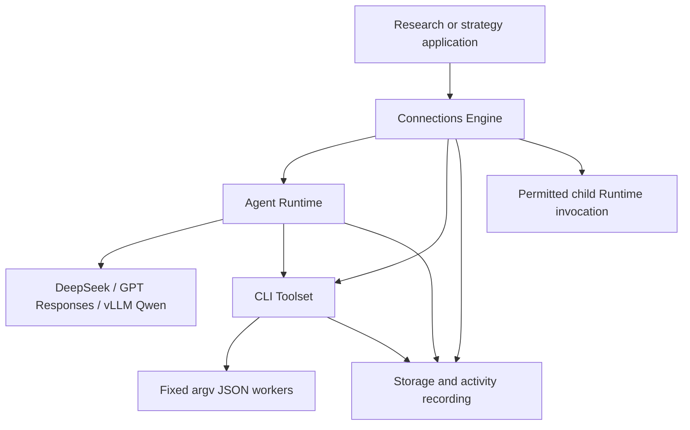

# EBD DeepResearch Engine

A group-project execution platform for Environment-Based Design deep research.
The runnable platform provides independent Agent Runtime, CLI Toolset,
Storage and Connections modules. Strategy is application code built on their
public interfaces. Development now runs in one chat with in-chat subagents;
the earlier cross-session team design is retained as historical context.

## Environment

- Use uv for Python, virtual environments, dependency resolution, and execution.
- Support Python 3.11 and later, with Python 3.11 as the shared development version.
- Declare dependencies in `pyproject.toml` and keep the generated `uv.lock` in version control.
- Keep virtual environments, local Python installations, caches, and credentials out of version control.

From the project root:

```shell
uv sync --locked
uv run --locked python --version
```

Add a runtime dependency with `uv add PACKAGE`, or a development dependency
with `uv add --dev PACKAGE`. Commit the resulting changes to `pyproject.toml`
and `uv.lock` together. Run Python programs through `uv run --locked`.

Runtime dependencies and development checks are pinned in the lockfile.
Credentials belong in ignored `local/.env`; `.env.example` lists the variable
names. API values are loaded lazily and never included in worker requests or
serializable configuration.

## Platform scope

1. Agent definition and runtime: define and execute agents against real models.
2. CLI toolset: discover registered tool definitions and execute real commands.
3. Storage and recording: persist state, artifacts, and automatic execution events.
4. Connections: bind agents to models, tools, storage, and permitted agent invocations.

## Runnable entry points

```shell
uv sync --locked
uv run --locked pytest -q
uv run --locked ebd tools
uv run --locked ebd tool scholar.crossref.search --arguments '{"query":"Environment Based Design","max_results":3}'
uv run --locked ebd --store local/ebd-baseline-store baseline
```

PowerShell can pipe a single-quoted JSON string to `ebd tool NAME` when command
argument quoting is inconvenient. All registered commands use fixed argv,
strict JSON and real subprocesses; the host records committed intent before
dispatch and outcome after cleanup. A tool run does not open a model.

The baseline generates a real DeepSeek report for the exact question
`What is EBD (Environment Based Design)`, with platform function tools as its
only research mechanism. It exports report, citations, request audit, trace,
terminal checkpoint and byte-identical reopen verification under
`local/runs/<run_id>/`. Failed runs retain their actual diagnostics.

See [Connections](docs/usage/connections.md),
[Agent Runtime and providers](docs/usage/agents.md),
[Storage](docs/usage/storage.md), and [CLI tools](docs/usage/tools.md).
Start a custom application with [examples/research.py](examples/research.py).
Bounded provider checks are in
[examples/live_provider_check.py](examples/live_provider_check.py).



Storage owns state CAS, immutable artifacts/snapshots/checkpoints and event
receipts. CLI workers receive bounded inputs and prepared evidence, with
Storage publication mediated by their parent. Connections owns trusted
configuration, grants, lineage budgets, leases and result export. The Runtime
owns native model/tool pairing, admission and execution lifecycle.

Local vLLM Qwen requires a configured deployment manifest and a deployed
service; live verification remains pending on this machine. API checks depend
on the configured account's model access and available credit.

## Design references

All teams follow [CONTRIBUTING.md](CONTRIBUTING.md): one uv/lockfile
environment, assigned file ownership, GitHub account attribution through a
noreply identity, and PM-only staging/commits/pushes in the shared checkout.

The reviewed designs are indexed by
[the team spec index](docs/teams/README.md), the shared platform draft, and
their module spec. `AGENTS.md` defines current in-chat source ownership.
See [platform acceptance](docs/platform-acceptance.md) for completed checks,
the saved report and outstanding live-provider verification.

The selected tools use DDGS Yahoo discovery, separate Crossref/OpenAlex
scholarly discovery, HTTPX retrieval, Trafilatura HTML extraction and pypdf
text-PDF extraction. Google remains disabled pending the URL-fidelity gate.
Discovery availability is best effort; source access failures and quota limits
remain explicit. OpenAlex reservations and settlement survive Engine restart
through normal Storage state.

## CLI tool contract

Executable shared values live in `src/ebd/contracts/`.

- Register each tool's name, description, input/output schemas, command arguments, and execution limits.
- Accept one UTF-8 JSON request on standard input.
- Return one JSON response on standard output; write diagnostics to standard error.
- Exit with code zero for success and a nonzero code for failure, returning structured error details.
- Execute registered command arguments without a shell.
- Record each invocation's start and outcome, including timeout and cancellation, through the engine.

Tool processes form the external execution boundary. Agent, storage, and
connection modules communicate through Python interfaces.

## uv references

- [Working on projects](https://docs.astral.sh/uv/guides/projects/)
- [Locking and syncing](https://docs.astral.sh/uv/concepts/projects/sync/)
