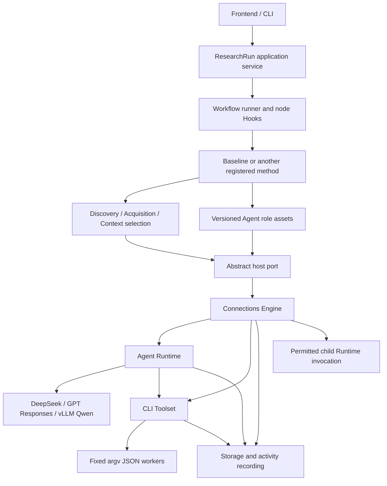

# DeepResearch Engine

A modular execution platform for reusable deep research methods.
The engine provides Agent Runtime, Toolset, Storage and Connections. Reusable
Workflows compose those capabilities into methods. The new Baseline separates
discovery, URL-manifest acquisition, saved evidence selection and a tool-free
Writer. Development runs in one chat with in-chat subagents;
the earlier cross-session team design is retained as historical context.

The Python package is `deepresearch`, the installed distribution is
`deepresearch-engine`, and the CLI command is `deepresearch`. The eight platform
blocks live in `src/deepresearch/`. Environment-Based Design (EBD) is a future
research method under `methods/ebd`, not the name or owner of the platform.
`src/ebd/__init__.py` is the only deprecated import bridge; the old `ebd` CLI
is also an alias. See the [directory and migration map](docs/architecture/project-structure.md).

## Start working with the team

Read [Team start](docs/team-start.md) for environment setup, role-specific
entry points, interface ownership and the first integration milestone.
Method authors use the [Workflow guide](docs/usage/workflows.md) and
[implemented structure](docs/architecture/project-structure.md).
Console authors use the [ResearchRun API](docs/usage/research-service.md)
and the generated [OpenAPI contract](docs/api/openapi.json). These are the
current onboarding documents; old team briefs are historical design records.

## Environment

- Use uv for Python, virtual environments, dependency resolution, and execution.
- Support Python 3.11 and later, with Python 3.11 as the shared development version.
- Declare dependencies in `pyproject.toml` and keep the generated `uv.lock` in version control.
- Keep virtual environments, local Python installations, caches, and credentials out of version control.

From the project root:

```shell
uv sync --locked
uv run --locked python --version
```

Add a runtime dependency with `uv add PACKAGE`, or a development dependency
with `uv add --dev PACKAGE`. Commit the resulting changes to `pyproject.toml`
and `uv.lock` together. Run Python programs through `uv run --locked`.

Runtime dependencies and development checks are pinned in the lockfile.
Credentials belong in ignored `local/.env`; `.env.example` lists the variable
names. API values are loaded lazily and never included in worker requests or
serializable configuration.

## Platform scope

1. Agent definition and runtime: define and execute agents against real models.
2. CLI toolset: discover registered tool definitions and execute real commands.
3. Storage and recording: persist state, artifacts, and automatic execution events.
4. Connections: bind agents to models, tools, storage, and permitted agent invocations.

## Runnable entry points

```shell
uv sync --locked
uv run --locked pytest -q
uv run --locked deepresearch methods
uv run --locked python examples/workflow_method.py
uv run --locked python examples/workflow_hooks.py
uv run --locked python examples/live_research_check.py
uv run --locked deepresearch tools
uv run --locked deepresearch tool scholar.crossref.search --arguments '{"query":"Environment Based Design","max_results":3}'
uv run --locked deepresearch --store local/my-research research < examples/baseline-request.json
uv run --locked deepresearch --store local/console-store serve --port 8000 --origin http://localhost:5173
```

PowerShell can pipe a single-quoted JSON string to `deepresearch tool NAME` when command
argument quoting is inconvenient. All registered commands use fixed argv,
strict JSON and real subprocesses; the host records committed intent before
dispatch and outcome after cleanup. A tool run does not open a model.

The new baseline runs real search/fetch/read tools before invoking DeepSeek.
It archives raw discovery results, FetchManifest, SourceManifest, ContextPlan,
selected evidence, report, usage and checkpoints. No search snippet or fetch
preview enters an Agent automatically. Model-labelled estimates remain distinct
from verified tokenizer counts. Failed sources retain their actual diagnostics.
For PowerShell, pipe `Get-Content -Raw examples/baseline-request.json` to the
`deepresearch ... research` command instead of using `<` redirection.

The model-free examples run real Storage and need no credentials. A live full
method check is `uv run --locked python examples/live_research_check.py
--request examples/baseline-request.json --store local/my-http-baseline`.
It makes real model/tool calls and verifies HTTP/SSE, idempotency and identical
report bytes after restart. See [Stage 1/2 acceptance](docs/research-acceptance.md).
The old `deepresearch baseline` command preserves legacy single-Agent report verification.

See [Connections](docs/usage/connections.md),
[Agent Runtime and providers](docs/usage/agents.md),
[Storage](docs/usage/storage.md), and [CLI tools](docs/usage/tools.md).
Start a custom application with [examples/research.py](examples/research.py).
Bounded provider checks are in
[examples/live_provider_check.py](examples/live_provider_check.py).
The [console run service](docs/usage/service.md) serves real runs and saved
results at `http://127.0.0.1:8000/api/v1`; its OpenAPI is at `/openapi.json`
and interactive API documentation at `/docs`. It owns one Engine and Store.
Python strategies can [delegate selected evidence](docs/usage/connections.md)
to child agents without sharing unrestricted Storage authority.
See [consumer acceptance](docs/consumer-acceptance.md) for the actual HTTP,
model/tool, evidence-sharing and restart checks.



Storage owns state CAS, immutable artifacts/snapshots/checkpoints and event
receipts. CLI workers receive bounded inputs and prepared evidence, with
Storage publication mediated by their parent. Connections owns trusted
configuration, grants, lineage budgets, leases and result export. The Runtime
owns native model/tool pairing, admission and execution lifecycle.

Each model response records provider-reported input/output/total tokens in
its `model.outcome` Storage activity, including available cache and reasoning
breakdowns. Run totals link those individual records. Missing counts remain
unknown; valid usage is retained even when response content fails validation.
See [token usage retrieval](docs/usage/storage.md) for the public history API.

Local vLLM Qwen requires a configured deployment manifest and a deployed
service; live verification remains pending on this machine. API checks depend
on the configured account's model access and available credit.

## Design references

All teams follow [CONTRIBUTING.md](CONTRIBUTING.md): one uv/lockfile
environment, assigned file ownership, GitHub account attribution through a
noreply identity, and PM-only staging/commits/pushes in the shared checkout.

The reviewed designs are indexed by
[the team spec index](docs/teams/README.md), the shared platform draft, and
their module spec. `AGENTS.md` defines current in-chat source ownership.
See [platform acceptance](docs/platform-acceptance.md) for completed checks,
the saved report and the pending local Qwen deployment check.

The selected tools use DDGS Yahoo discovery, separate Crossref/OpenAlex
scholarly discovery, HTTPX retrieval, Trafilatura HTML extraction and pypdf
text-PDF extraction. Google remains disabled pending the URL-fidelity gate.
Discovery availability is best effort; source access failures and quota limits
remain explicit. OpenAlex reservations and settlement survive Engine restart
through normal Storage state.

## CLI tool contract

Platform values live in `src/deepresearch/engine/contracts/`; research manifests and
frontend run DTOs live in `src/deepresearch/workflows/contracts.py`. Runtime modules live
under `engine/`; the single deprecated import bridge is `src/ebd/__init__.py`.

- Register each tool's name, description, input/output schemas, command arguments, and execution limits.
- Accept one UTF-8 JSON request on standard input.
- Return one JSON response on standard output; write diagnostics to standard error.
- Exit with code zero for success and a nonzero code for failure, returning structured error details.
- Execute registered command arguments without a shell.
- Record each invocation's start and outcome, including timeout and cancellation, through the engine.

Tool processes form the external execution boundary. Agent, storage, and
connection modules communicate through Python interfaces.

## uv references

- [Working on projects](https://docs.astral.sh/uv/guides/projects/)
- [Locking and syncing](https://docs.astral.sh/uv/concepts/projects/sync/)
