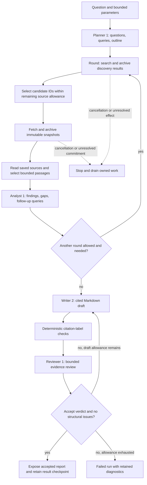

# Baseline method revision 2

Revision 5 is the current experiment entry point. It adds bounded parallel source
distillation, complete or explicitly partial archived reads, gap-driven source
access, alternate acquisition and independent research-quality status. See
[parallel usage and module interfaces](../usage/baseline-parallel.md).

Revision 4 preserves the expanded
revision 3 budgets and search tool pin, adds Writer 4 and Reviewer 3 for English
reports, and rejects CJK narrative before final publication. EBD experiment
input remains exactly `What is EBD (Environment Based Design)?`.

Revision 3 reuses this method's stages with a whole-run allowance of 20 attempted
URLs, at most two research rounds, 128k default evidence tokens and four 256k
Agent roles. See [expanded usage](../usage/baseline-expanded.md). Revision 2 and
its role resources remain available with their earlier limits.

`baseline@2` is the formal, bounded research method for arbitrary questions.
It plans research, acquires and archives sources, analyzes selected passages,
then writes and reviews a report. Its four Agent roles run in the common Runtime
with no tools. Search, fetch, saved-document reads and publication belong to
Workflow components through the application port.

The [usage guide](../usage/baseline.md) gives requests, parameter limits and
CLI/HTTP examples. [Research acceptance](../research-acceptance.md) records
actual integration and live checks; this design does not assert a test count
or a successful external run.

## Versions and pins

Bootstrap registers Baseline revisions 1–5 and `example.echo@1`.
`ResearchRunRequest.method_revision` still defaults to **1** for compatibility.
New consumers must send `method_id: "baseline", method_revision: 2` explicitly.
Wire `schema_version: 1` and HTTP `/api/v1` are independent of method revision.

| Method | Behavior | Role pins |
| --- | --- | --- |
| `baseline@1` | One discovery/acquisition/context pass followed by a Writer | `baseline.writer@1` |
| `baseline@2` | Plan, bounded research rounds, analysis, synthesis and review | `baseline.planner@1`, `baseline.analyst@1`, `baseline.writer@2`, `baseline.reviewer@1` |
| `baseline@3` | Expanded budgets and observed search | `baseline.planner@2`, `baseline.analyst@2`, `baseline.writer@3`, `baseline.reviewer@2` |
| `baseline@4` | Expanded research with English report instructions and publication checks | `baseline.planner@2`, `baseline.analyst@2`, `baseline.writer@4`, `baseline.reviewer@3` |
| `baseline@5` | Archived reads, parallel source distillation, recovery and independent coverage | `baseline.planner@3`, `baseline.distiller@1`, `baseline.analyst@3`, `baseline.writer@5`, `baseline.reviewer@4` |
| `example.echo@1` | Model-free integration over real Storage | No Agent roles |

The old method lives in `methods/baseline/v1/` with its own schemas. Its parameter
limits remain separate from v2. `deepresearch baseline` is the older single-Agent
CLI under `interfaces/cli/legacy_baseline.py`; it is not either registered
Baseline method. Method consumers use `deepresearch research`.

Each role revision in `agent_catalog/resources/<role>/<revision>/` has the
standard five files: `definition.json`, `instructions.md`, `task.md`,
`input.schema.json` and `output.schema.json`. The method pins exactly four roles;
role revisions are independent of method revisions. Admission retains method,
component and role asset digests, profile/model selection and the tool catalog.

## Execution and publication

Planner produces a validated `ResearchPlan` containing an objective, research
questions, literal queries and an outline. Explicit user queries replace its
search queries, while planning still runs. Queries must fit `max_queries`;
a whitespace-only question or an oversized literal query is rejected.

Each round archives discovery tool outcomes before projecting candidate URLs.
Raw referrals and search metadata remain discoverable artifacts; candidate
projection is not a fetch, and search snippets do not become source evidence.
Discovery tries the configured search tools in order for each query until one
produces candidates. The Workflow deduplicates exact URLs, includes supplied
`source_urls` in the first round, applies `discovery.select`, and archives the
bounded `FetchManifest`. These supplied URLs do not disable planning or search.

Acquisition is sequential and model-free. Successful snapshots require committed
publication and complete recording. `SourceManifest` retains per-source status,
provenance, snapshot reference and diagnostics. Ordinary recorded source-access
failures can coexist with usable sources; successful partial acquisition remains
available if a later stage fails. Cancellation, shared-limit exhaustion,
unconfirmed cleanup or an unknown effect/commitment stop execution. The method
never automatically refetches an uncertain action.

Context selection considers successful retained sources, applies `context.select`,
then scans each source within the per-source, per-round byte allowance. The shared
component chooses a relevant saved passage, fits selected text and assembled
provenance blocks within the configured evidence policy, and records hashes,
requested ranges, delivered byte bounds, truncation, read action and measurement.
A requested range does not claim complete delivery of that range or document.
No usable retained source or no evidence fitting the policy produces `NO_EVIDENCE`.

Analyst receives the plan, current selected evidence, allowed source IDs and round
number. `EvidenceAnalysis` contains findings, gaps, follow-up queries and a
`sufficient` flag. Validation requires unique finding identities, known plan
questions and references only to the **current selected** source IDs. An earlier
snapshot or an unselected successful source does not itself authorize a citation.
Later rounds can select earlier successful sources again; only new literal
queries and previously unattempted URLs are dispatched.

Writer receives the plan, final analysis and final selected evidence. Its
`ContextPlan` names `baseline.writer` as recipient. Reviewer receives the same
selected evidence plus the draft and analysis. A review returns `accept` with
no issues or `revise` with bounded actionable issues. Both model review and
structural checks must pass. Structural issues and review feedback feed the next
Writer invocation, with at most `max_report_attempts` draft/review pairs (1–2).
This explicit revision loop does not retry failed or uncertain external actions.
Exhaustion returns `REPORT_REVIEW_FAILED`.

The label checker requires a nonblank report, at least one recognized
`[source-id]` citation, and no unknown labels matching its citation syntax.
Citation labels must belong to the final `ContextPlan.selections`; Markdown
links and image links are not evidence labels. Reviewer also checks support,
reasoning, missing citations and limitations against the supplied text. The
label checker cannot prove that every claim is cited or that a citation supports
its claim. Neither a valid label nor model acceptance guarantees external factual
accuracy, exhaustive source coverage or resistance to every prompt injection.

Every draft remains a retained artifact, including rejected drafts. Only an
accepted draft becomes the method's `report_ref`; rejection never promotes a
draft to a successful report. Application success additionally requires the
saved projection, a committed `workflow.finished` receipt, settled Hook/session
cleanup and a Storage completion attestation. A report reference alone is not
proof of successful terminal completion. A large `workflow.finished` event may
omit the full `nodes` array and retain `node_count`/`nodes_sha256` to fit the
16 KiB event bound. Complete nodes remain in the persisted view and node events.

## Bounded stopping and evidence gaps

The successful result manifest records one `stop_reason`. Conditions are evaluated
in this order after each validated analysis; otherwise the loop reaches its cap.

| Reason | Meaning | What it does not establish |
| --- | --- | --- |
| `evidence_sufficient` | Analyst judged the currently selected evidence sufficient | Independent truth or complete coverage |
| `source_limit` | The whole-method allowance for attempted unique URLs was consumed | That all attempted sources succeeded |
| `no_new_queries` | Analyst supplied no follow-up query not already searched | That the question has been fully answered |
| `round_limit` | The configured research-round cap was reached | That no relevant evidence exists elsewhere |

`max_sources` counts attempted unique URLs, including recorded failed fetches;
it is not a per-round allowance or a count of successful sources. `max_queries`
is the per-round query cap. All stages and child invocations share lineage
budgets, deadline and cancellation. Starting another node, round or role does
not replenish the root budget.

The default shared `storage_writes=4096` provides recording capacity for the
formal flow's child invocations, nodes and projections. Deployments can explicitly
narrow this allowance; other resource limits remain independent. It is still
shared by the whole tree, and a method cannot increase its grant. Allowed input
maxima do not guarantee enough host budget to exhaust all maxima simultaneously.

An analysis may retain gaps even when the method moves to synthesis. The final
analysis, review issues, source failures, selected ranges and stop reason explain
that boundary. A limited report can be accepted if it accurately describes what
the supplied passages support and what remains unknown. A failure before
synthesis is an error outcome, not an invented successful stop reason.

## Retained evidence and recovery contract

After durably saving the run identity, admission publishes the canonical full
`ResearchRunRequest` in `research-request.json`. The method manifest and
`workflow.accepted` event carry its `request_ref`; the original fingerprint is
retained. `ResearchRunView` gains no new wire field. Input and intermediate
decisions remain inspectable as artifacts/checkpoints alongside the projection;
a fingerprint alone cannot reconstruct the input and parameters.

| Retained material | Producer and purpose |
| --- | --- |
| `research-request.json` and `research-method.json` | Host admission: full canonical request; manifest `request_ref` and exact execution/resource pins |
| Planner output and `baseline-plan/2` checkpoint | Pinned Planner output and plan reference |
| `rN.discovery.*.json`, `rN.fetch-manifest.json` | Raw recorded discovery outcomes/referrals and selected fetch intent |
| Snapshots and `rN.source-manifest.json` | Acknowledged source bodies, provenance and per-item failures |
| `rN.selected-context.txt` and round `ContextPlan` | Exact evidence bytes and selection/measurement metadata |
| Analyst output and `baseline-research/2` checkpoint | Findings, gaps, follow-ups and accumulated round references |
| `writer-context-plan.json` | Final evidence delivery to Writer |
| Writer/Reviewer output artifacts, `report.N.validation.json`, `baseline-review/2` checkpoint | Every draft, review, structural issue and acceptance decision |
| `research-result.json` and `baseline-result/2` checkpoint | Stop reason, rounds, discovery sets, sources, drafts and accepted report reference |

Publication proceeds only through `PlatformPort`. Valid child outputs are
explicitly exported into the Workflow scope and read through bounded artifact
access. Runtime validation failures retain only a raw output artifact for
diagnosis: `output_ref` stays null and no valid output is exported. That raw
artifact is evidence of an attempted response, not accepted research content.
Application catalog/report/source readers retain run ownership checks.

Reopen permits inspection of committed facts and saved bytes. The same
`client_request_id` with the same full request returns the original run; a changed
request is a conflict. Missing terminal/completion evidence becomes `interrupted`.
`automatic_resume` is false: checkpoints do not authorize repeating search,
fetch, model calls or publication. Cancellation requests must drain to a settled
view; disconnecting an HTTP/SSE subscriber does not cancel the research task.

## Measurement, usage and Hooks

Evidence token measurements distinguish `verified`, `estimated` and `unknown`.
Default estimates identify their estimator and model; unknown counts remain null.
`strict_tokens` requires a host-registered tokenizer for the selected model and
fails when it cannot obtain a verified count. `context_tokens` covers rendered
evidence blocks, not the entire role request, model output or run's spend.
Runtime applies its own full-request limits. These policies do not promise a
hard exact provider token budget.
Each formal role explicitly declares `max_context_tokens=131072` and
`max_task_input_bytes=131072`. Current provider preflight estimates complete
request tokens as `ceil(UTF-8 bytes / 4)`, including instructions, analysis
and a reviewed draft. It is separate from the evidence budget and is not a
claim about the model's native capacity. Deployment/host limits can narrow it.

Usage is cumulative across observed Planner, every Analyst and every Writer and
Reviewer attempt, including available usage from failed/invalid outputs. It is
not the last Writer's total. Known subtotals and deduplicated per-attempt activity
references preserve provider observations; completeness stays `complete`,
`partial` or `unknown`, and missing counts are not fabricated as zero. Logical
role executions, provider attempts and evidence token estimates are different
quantities.

Node lifecycle supports `node.before`, `node.after` and `node.failed`; observers
receive `kind`, `status` and `detail_sha256` metadata with node/run identity.
`discovery.select` and `context.select` controls may subset/reorder existing IDs,
but cannot introduce sources, increase allowances or grant authority. Full
bounded node facts and Hook decisions are committed events; bulky source text
remains in artifacts. A complete method runs with an empty `ExtensionRegistry`.
Extensions are trusted host callbacks with bounded dispatch and cleanup; see
[Hooks](../usage/extensions.md).

## Module responsibilities

`methods/baseline/workflow.py` owns orchestration and `contracts.py` owns Baseline
research decisions. `stages/roles.py` validates role output/evidence bindings;
`stages/reporting.py` owns draft/review and deterministic label validation.
`resources/2/` supplies method/input/parameter schemas. Reusable discovery,
acquisition, selection and invocation components live in `workflows/components/`.

`workflows/context.py` declares `PlatformPort`; `application/platform.py`
implements it using the Engine. `application/research_runs.py` owns admission,
run tasks, idempotency, cumulative usage and terminal reconciliation. Agent
bundles live in `agent_catalog/`; bootstrap registers concrete methods. HTTP and
CLI consume the application service. See the [directory and dependency map](project-structure.md).
