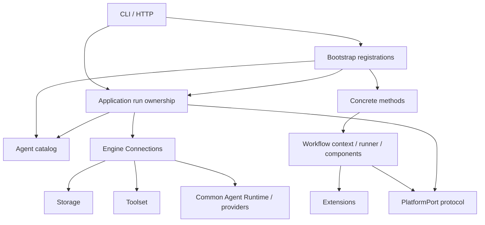

# Project structure and dependency rules

DeepResearch Engine separates execution capabilities, Workflow composition,
concrete research methods, role assets, optional extensions, application ownership,
interfaces and bootstrap. `baseline@6` is the current formal method built over
those modules: Planner 3, bounded acquisition/archived reads, parallel Distiller 1,
Analyst 3, Writer 5 and Reviewer 4, with independent research-quality status.
See [Baseline architecture](baseline.md) for its flow and research contracts.

The platform package is `deepresearch`; the distribution is `deepresearch-engine`
and CLI is `deepresearch`. `src` is the Python source root. Environment-Based
Design belongs in a future `methods/ebd` alongside Baseline; this layout does not
claim an EBD implementation.

## Source map

```text
src/deepresearch/
  engine/
    contracts/             execution values, grants, receipts, budgets
    connections/           Engine, model-free Workflow sessions, invocation/access
    agent/                 shared Agent container and Runtime
    providers/             native model connectors and observed usage
      tokenization/        registered tokenizer and estimate policies
    toolset/               fixed-argv search/fetch/read workers
    storage/               SQLite state, immutable objects and event receipts
  agent_catalog/
    catalog.py             validate, resolve, render and compile pinned roles
    resources/<role>/<revision>/
      definition.json      tool requests, limits and output delivery
      instructions.md      role instructions
      task.md              structured-input rendering template
      input.schema.json
      output.schema.json
  workflows/
    contracts.py           FetchManifest, SourceManifest, ContextPlan, Run DTOs
    registry.py            immutable MethodDefinition and registry
    context.py             PlatformPort protocol and node lifecycle
    runner.py              execute a registered method under a method node
    components/
      discovery.py         discovery archives and provider-specific projection
      acquisition.py       URL manifest -> acknowledged immutable snapshots
      context_selection.py saved-source scanning -> bounded evidence
      agents.py            invoke a pinned role and read its exported artifact
      retrieval.py         bounded query recovery and available work locations
      source_access.py     complete/explicitly partial recorded source reads
      parallel.py          bounded tasks and sibling cancellation/drain
      quotations.py        exact saved quote location and PDF soft word wraps
  methods/
    baseline/
      workflow.py          formal revision 2 orchestration
      parallel_workflow.py revisions 5–6 parallel evidence orchestration
      contracts.py         ResearchPlan, EvidenceAnalysis and ReportReview
      evidence_contracts.py source digests and range-read decisions
      stages/
        roles.py           structured role decisions and evidence validation
        reporting.py       bounded drafting/review and citation-label checks
        distillation.py    parallel source roles and verified quotations
        evidence_delivery.py digests and recorded text -> synthesis evidence
      resources/2/         method.json, input.schema.json, parameters.schema.json
      resources/3..5/      preserved newer method schemas and role pins
      v1/                  retained revision 1 workflow and schemas
    example_echo/          real model-free integration method
  extensions/              Hook contracts, registry, dispatcher and cleanup
  application/
    research_runs.py       research admission, identity, tasks, terminal/reopen
    platform.py            concrete PlatformPort adapter using the Engine
    usage.py               cumulative observed child-attempt usage
    agent_runs.py          individual-Agent run service
    agent_contracts.py     individual-Agent application/HTTP DTOs
  interfaces/
    http/                  FastAPI composition, routes and committed SSE
    cli/                   methods/research/tools/serve and legacy baseline
      legacy_baseline.py   separate historical single-Agent CLI
  bootstrap/               explicit method/catalog/service composition
src/ebd/
  __init__.py              deprecated import bridge; no implementation tree
tests/                     module, application, HTTP and boundary checks
examples/                  executable consumers, never implementation dependencies
docs/                      setup, architecture, usage and acceptance evidence
```

Method 2 pins `baseline.planner@1`, `baseline.analyst@1`, `baseline.writer@2` and
`baseline.reviewer@1`, each with the five standard resources above. Writer 1 and
the v1 method remain available. Bootstrap registers `baseline@1` through `baseline@6`
and `example.echo@1`; wire `method_revision` defaults to 1 for compatibility.
New consumers explicitly request 6. HTTP `/api/v1` and wire schema 1 do not select
the method revision.

## Dependency direction and ownership



| Layer | Allowed dependency | Responsibility excluded |
| --- | --- | --- |
| Engine contracts | Standard library / validation support | Research decisions, role prompts, transport |
| Engine modules | Engine contracts and composed engine modules | Workflows, concrete methods, application, HTTP |
| Agent catalog | Engine definitions and validation | Method execution or task ownership |
| Extensions | Execution errors and immutable metadata | Session handles, credentials or unscoped Storage |
| Workflow framework | Engine values, token measurement, extensions | Concrete method imports, Engine construction, direct workers/database/network access |
| Concrete methods | Framework/components and shared values | Provider/HTTP construction, direct SQLite/network access |
| Application | Engine, Workflow contracts, role catalog, extensions | Hard-coded Baseline/EBD imports or research algorithm decisions |
| Interfaces | Application services/contracts and bootstrap | Research algorithm decisions |
| Bootstrap | Concrete methods and all composition inputs | Research algorithm itself |

`workflows/context.py` declares the abstract port for reusable components.
`application/platform.py` supplies the Engine-backed implementation. Method
code calls `context.port` and uses `context.node`; it never constructs providers,
fetches over its own HTTP client or opens Storage directly. All Agent roles use
the common Runtime; Baseline roles have no registered tools and perform no fetch.
The model-free root Workflow grants selected tool and child-invocation authority
through Connections, with one shared lineage ledger/deadline/cancellation.

`tests/architecture/test_layers.py` checks import boundaries. Add another method
under `methods/<name>/`, pin its schemas/roles and register it in bootstrap.
Engine and frontend lifecycle code should remain method-independent.

## Contracts and durable facts

| Contract | Producer -> consumer | Meaning |
| --- | --- | --- |
| `MethodDefinition` | Method -> registry/application/UI | Input/parameter schemas, method/role revisions and asset digests |
| `FetchManifest` | Method -> acquisition | Stable IDs and literal HTTP(S) URLs; no source body |
| `SourceManifest` | Acquisition -> method/UI | Per-item status, snapshot, provenance, committed recording and measurements |
| `ContextPlan` | Selection -> Analyst/Writer/UI | Chosen snapshot/range/bytes, read action, hashes and context artifact |
| `ResearchPlan` / `EvidenceAnalysis` / `ReportReview` | Baseline roles -> Baseline stages | Method-specific structured research decisions |
| `SourceDistillation` / `DistilledAnalysis` | Baseline source/analysis roles -> stages | Source-bound quotes and gap-driven read requests |
| `ResearchQuality` | Method -> run view/result/UI | Research coverage independent of execution/report acceptance |
| `AgentSpec` | Catalog -> common Runtime | Instructions, template, schemas and host-constrained limits/tool requests |
| `ResearchRunRequest/View` | Frontend/CLI -> application | Intent identity, version/model pins, nodes, sources, refs, terminal facts and usage |
| `HookEvent/Decision` | Node/selection -> extension | Immutable metadata and validated subset/reordering |

The method's v2 schemas live in `methods/baseline/resources/2/`; v1 retains its
own schemas in `v1/`. Research decisions belong to `methods/baseline/contracts.py`,
not generic engine or HTTP DTOs. Generic Workflow contracts are authority-free
serializable values. Individual-Agent DTOs are in `application/agent_contracts.py`.

Acquisition is sequential and deduplicates exact URLs within execution. New runs
fetch fresh sources; no automatic cross-run reuse or uncertain refetch is assumed.
Partial successful snapshots remain readable when other sources or later stages
fail. Input, plan, discovery/referrals, analyses, selected text, drafts, reviews,
validation and result/checkpoints remain inspectable. Host admission archives
the canonical full request as `research-request.json` after durable identity
save; `research-method.json` and `workflow.accepted` carry `request_ref` while
RunView stays unchanged. Only an accepted final draft is exposed as the Baseline
report. Runtime validation failure retains raw diagnostic bytes with null
`output_ref` and no valid export.

The host owns idempotency, task lifetime, saved projections and terminal
reconciliation. Success needs acknowledged `workflow.finished`, persisted state,
settled Hook/session cleanup and a completion attestation. A large terminal event
omits an oversized `nodes` array and retains `node_count`/`nodes_sha256` within its
16 KiB bound; complete nodes remain in the persisted view and node events.
Missing/inconsistent completion is `interrupted` after reopen. Checkpoints are
facts, not authority to resume; `automatic_resume` is false.

## Bounds, measurements and usage

The host sets resource grants. Default `storage_writes=4096` accommodates the
formal method's child records, nodes and projections. It remains a shared tree
allowance; host configuration can narrow it and other limits remain independent.
A new role, node or round does not reset budgets. Parameter maxima describe
allowed method inputs, not a guarantee that all maxima can be used together
within the configured host deadline/storage/model/tool limits.

Evidence token measurements distinguish verified, estimated and unknown counts.
Estimates identify their model and estimator; unknown counts are null. Selected
and assembled evidence have separate hashes/measurements. Strict mode requires
a registered tokenizer for the selected model. The evidence budget covers
assembled passages/provenance; Runtime separately bounds complete rendered role
requests. Neither promises hard exact provider token spend.

Provider usage aggregates observed attempts across Planner, source Distillers, every Analyst and
all Writer/Reviewer drafts, including available observations from failed outputs.
Known subtotals, completeness and per-attempt event references preserve available
facts. Do not replace missing counts with zero or report only the last Writer.

## Hooks and frontend events

Nodes emit committed started/completed/failed events and expose `node.before`,
`node.after`, `node.failed`. Observers receive kind/status/detail digest metadata
with run/node identity; full bounded node details remain in workflow events.
Discovery and context controls may subset/reorder existing IDs at
`discovery.select` and `context.select`. They cannot add URLs, increase budgets,
create grants or mutate requests. Full methods run with an empty registry.

Observer failures/timeouts are recorded; invalid controls stop execution.
Callbacks are trusted host code and must cooperate with cancellation. Dispatcher
cleanup reports retained resources when a callback does not settle. This is not
an execution sandbox for arbitrary extensions.

HTTP polling/SSE replays committed sequence IDs and child-role history. It is not
model-token streaming. Report/source/artifact reads use saved-object access and
do not rerun research. Model review, role instructions and citation labels do
not guarantee semantic correctness, full source coverage or injection immunity.
Automatic resume, distributed scheduling and multi-user hosting are outside the
current ownership model. Root records checks in [research acceptance](../research-acceptance.md).

## Import migration

Former flat engine/service directories have been removed. Compatibility is
concentrated in `src/ebd/__init__.py`, resolving former flat and intermediate
layered `ebd.*` imports lazily to canonical module objects. New repository code
uses `deepresearch.*`; dedicated compatibility checks exercise old imports.
The `ebd` executable remains an alias.

| Former import | Canonical import |
| --- | --- |
| `ebd.engine.*` and flat `ebd.connections/agent/providers/toolset/storage/contracts` | `deepresearch.engine.*` |
| `ebd.agent_catalog`, `ebd.workflows`, `ebd.methods`, `ebd.extensions` | Corresponding `deepresearch.*` package |
| `ebd.application`, `ebd.interfaces`, `ebd.bootstrap` | Corresponding `deepresearch.*` package |
| `ebd.service.runs` / `ebd.service.models` | `deepresearch.application.agent_runs` / `agent_contracts` |
| `ebd.service.api` | `deepresearch.interfaces.http.api` |
| `ebd.cli` / `ebd.baseline` | `deepresearch.interfaces.cli.main` / `legacy_baseline` |

For the former mixed facade, import `RunService` from
`deepresearch.application.agent_runs` and `create_app` from
`deepresearch.interfaces.http`. Namespace migration itself preserves saved Store
formats and HTTP v1 contracts. Method v2 is selected explicitly rather than by
changing old import spelling. Historical records keep the names used at their
original acceptance; new work follows current guides.
