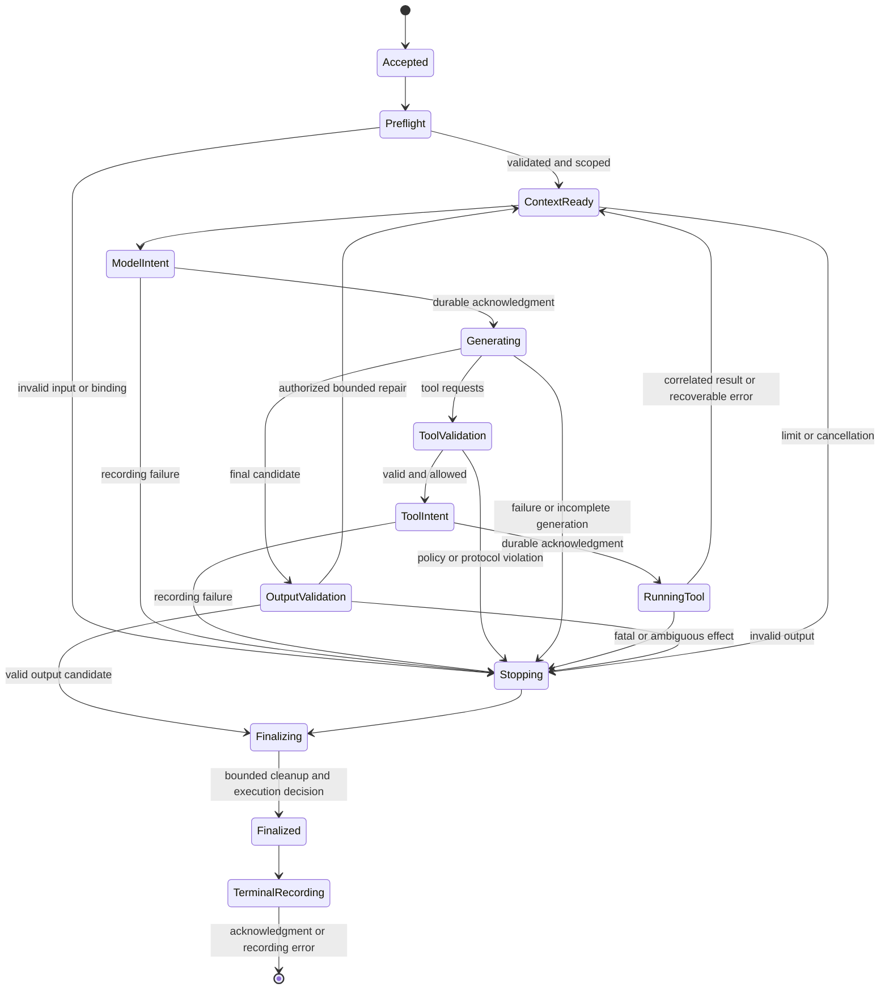

# Agent Container design proposal

Status: DRAFT v0.1 for PM and cross-team reconciliation. Date: September 30, 2026 (America/Toronto). This completes the team's current design/research assignment; it does not authorize implementation or freeze shared types.

## Recommendation and scope

Use one asynchronous, bounded agent execution loop with provider-specific adapters. Connections resolves immutable bindings and effective permissions; Container owns agent definitions, context assembly, model/tool decisions, validation, limits, and lifecycle events. CLI Toolset launches registered processes and returns execution details. Storage persists activities and commits state/artifacts. Strategies consume validated agent results without handling provider-native conversation formats.

Recommend OpenAI Responses for the exact required model `gpt-6-luna`; propose DeepSeek Chat Completions for the first adapter, with an explicit model/thinking selection still needed; make Qwen/vLLM configuration a versioned deployment profile. The common interface can be reconciled while those selections remain open. Resolve only the chosen provider. An undeployed Qwen service must not prevent API agents from running.

The first handoff should support text/JSON tasks, registered function tools, sequential tool execution, bounded generation, local schema validation, durable recording, cancellation, and real configured services. Streaming, tool concurrency, automatic model retries, validation repair, checkpoint resume, and native strict-schema generation are optional capabilities. Model-provider hosted search, shell, MCP, agent registries, research strategy, and scheduling are outside this loop.

## Proposed common data contracts

These are proposals for shared definitions owned/reconciled by PM, rather than separate incompatible types in each package. JSON is UTF-8; timestamps are RFC 3339 UTC. Unknown major schema versions fail with `contract_version_unsupported`. Optional additive fields are tolerated only where the contract explicitly allows them; unknown execution/security settings fail rather than being ignored. Definitions are immutable within a run and carry a canonical content digest as well as a human version.

Use JSON Schema Draft 2020-12 for local input/output validation. Resolve only bundled local schema references; validation must not fetch arbitrary external `$ref` URLs. Provider schema support is a separate capability: an adapter either translates a schema without weakening a required constraint or rejects the requested native strict mode. Local validation always applies.

| Contract | Fields and behavior |
| --- | --- |
| `AgentDefinition` | `schema_version`, stable `agent_id`, `definition_version`, computed `definition_digest`, `instructions`, `input_schema`, `output_contract`, `model_ref`, optional validated `model_settings`, `required_capabilities`, explicit versioned `tool_permissions`, `storage_requests`, `delegation_requests`, `context_policy`, `limits`, `error_policy`. Settings use an adapter capability allowlist, never arbitrary HTTP fields. No secrets or live handles. |
| `OutputContract` | `mode: text|json`, local `schema` when applicable, `native_enforcement: optional|required|disabled`, maximum serialized bytes. Text can be validated as a JSON string against its declared local schema. An artifact-backed output is the same validated value stored through Storage, not an arbitrary unchecked path. |
| `ExecutionMetadata` | `run_id`, `agent_id`, current `action_id`, nullable `parent_action_id`, `correlation_id`, optional `parent_run_id`, UTC `deadline_at`, safe application `metadata`, definition/binding versions. `mission_id` is optional application metadata only. |
| `ExecutionContext` | Metadata plus effective grants, a live cancellation token, monotonic deadline timer, and shared inherited budget handle. Handles never enter JSON, events, or checkpoints. Connections allocates runs; its supplied identity allocator gives action owners fresh action IDs. |
| `BindingSet` | Contract/version and non-secret binding digest; selected `provider_factory`, model configuration reference, allowed immutable tool descriptors/executor, scoped Storage and Recorder, optional AgentInvoker, effective grants/limits, identity allocator. No universal unrestricted client. |
| `ProviderCapabilities` | Exact provider/model/protocol/profile identity; tool choice modes, multiple-call support, supported output/schema subset, continuation codec/persistence support, usage fields, context/output ceilings, counting quality, streaming and cancellation semantics. Every feature has `supported|unsupported|unknown` and evidence `documentation|local_validation|live_probe` with date/version. Unknown cannot satisfy a required feature. |
| `ModelRequest` | Ordered `input_items` for this step, allowed `tool_schemas` with immutable identity-to-provider-name mapping, `output_contract`, validated settings, effective output/context/time limits, optional continuation, model/action identity. Initial items contain instructions, typed task input and scoped context; later items contain correlated tool results or permitted repair feedback. |
| `InputItem` | Tagged instruction, user/task/context text, or tool result. Context/artifact excerpts carry immutable source/version/range references and trust role. Tool results carry the original provider `call_id`, normalized tool identity and structured success/error payload. Only the adapter translates these into endpoint-native messages. |
| `ModelResponse` | Public text/JSON candidate content, ordered `tool_calls`, `completion: final|tool_calls|incomplete|refused|failed`, native finish reason, optional usage, adapter-owned continuation, sanitized provider response/request IDs and error. Native reasoning never becomes public content. Text alongside tool calls is intermediate; do not accept it as final. |
| `ToolCall` | Provider `call_id`, stable response order/index, resolved tool identity/name, original argument JSON string plus parsed object or parse error. Detect duplicate/missing IDs; never generate an ID to conceal broken provider pairing. |
| `ToolRequest` | Registered tool/version, validated JSON arguments, original provider call ID, action context, scoped capability handle, effective timeout/byte limits. Registered argv belongs to Toolset and is never selected from model-supplied shell text. |
| `ToolResult` | `status: succeeded|failed|timed_out|cancelled`, schema-valid output or typed error, artifact/diagnostic refs, exit code or null, monotonic duration, output/stderr byte counts, cleanup confirmation, and `effect_state: not_started|completed|unknown`. Process success without a valid JSON/schema result is a protocol failure. |
| `AgentResult` | Identities/definition/binding digest; terminal status; validated inline output or immutable output reference; optional partial output explicitly unvalidated; structured primary/secondary cleanup and recording errors; usage/counters; `recording_status: complete|incomplete|unavailable`; unfinished action IDs; nullable terminal event reference; optional checkpoint ref. |
| `EngineError` | Stable `code`, safe `message`, owner/boundary, action identity, optional schema/path details, `retryable`, `effect_state`, optional provider code/HTTP status, restricted diagnostic ref. `retryable` describes eligibility, not authorization to replay. No raw authenticated request/exception dump. |

Definition example below uses symbolic references, not registered service or execution identifiers. Numeric limits are proposed example policy, not provider maximums or approved defaults.

```json
{
  "schema_version": "1.0",
  "agent_id": "<registered-agent-id>",
  "definition_version": "<definition-version>",
  "instructions": "Answer the supplied task using the permitted tools and source excerpts.",
  "input_schema": {
    "type": "object",
    "properties": {"task": {"type": "string", "minLength": 1}},
    "required": ["task"],
    "additionalProperties": false
  },
  "output_contract": {
    "mode": "json",
    "schema": {
      "type": "object",
      "properties": {"answer": {"type": "string"}},
      "required": ["answer"],
      "additionalProperties": false
    },
    "native_enforcement": "optional",
    "max_bytes": 65536
  },
  "model_ref": "<configured-openai-model-ref>",
  "required_capabilities": ["function_tools"],
  "tool_permissions": [{"tool_ref": "<registered-tool-ref>", "version": "<tool-version>"}],
  "storage_requests": [{"scope_ref": "<permitted-scope-ref>", "operations": ["read", "artifact_commit"]}],
  "delegation_requests": [],
  "context_policy": {"overflow": "fail", "max_input_bytes": 262144, "max_tool_excerpt_bytes": 16384},
  "limits": {
    "max_model_calls": 8,
    "max_tool_calls": 12,
    "max_output_tokens_per_call": 4096,
    "max_context_tokens": 32768,
    "max_run_seconds": 120,
    "max_model_seconds": 45,
    "max_tool_seconds": 30,
    "max_repairs": 0,
    "max_model_retries": 0
  },
  "error_policy": {"recoverable_tool_errors": "return_to_model", "unauthorized_tool": "terminate"}
}
```

Connections resolves the model reference to `model_id: gpt-6-luna`, a Responses protocol profile and a secret reference. Proposed variable labels for later example configuration are `OPENAI_API_KEY`, `DEEPSEEK_API_KEY`, and optional `VLLM_API_KEY`; endpoint/model/profile fields are separately named non-secret configuration. These names have not been compared with or read from `local/.env`. Connections defines precedence and maps existing names after approval; Container must not introduce a second environment loader.

Example payload fragments for one permitted tool cycle follow. Angle-bracket strings stand for registered references or values actually returned/allocated at execution. Usage `null` means unknown; it is not zero. The restricted artifact contains complete native continuation, not the abbreviated public view below.

```json
{
  "model_response": {
    "completion": "tool_calls",
    "content": [],
    "tool_calls": [{
      "call_id": "<provider-returned-call-id>",
      "order": 0,
      "tool_ref": "<permitted-registered-tool-ref>",
      "arguments_json": "{\"query\":\"<task-query>\"}",
      "arguments": {"query": "<task-query>"}
    }],
    "usage": null,
    "continuation": {
      "schema_version": "1.0",
      "codec_id": "<adapter-continuation-codec>",
      "codec_version": "<codec-version>",
      "provider": "openai",
      "protocol": "responses",
      "model_ref": "<configured-openai-model-ref>",
      "model_id": "gpt-6-luna",
      "profile_digest": "<profile-digest>",
      "run_id": "<allocated-run-id>",
      "agent_id": "<registered-agent-id>",
      "definition_digest": "<definition-digest>",
      "binding_digest": "<binding-digest>",
      "step_index": 1,
      "pending_calls": [{"call_id": "<provider-returned-call-id>", "tool_ref": "<permitted-registered-tool-ref>", "order": 0}],
      "payload_ref": "<restricted-finalized-artifact-ref>",
      "payload_digest": "<native-payload-digest>",
      "persistence": "restricted"
    }
  },
  "next_request_items": [{
    "kind": "tool_result",
    "call_id": "<provider-returned-call-id>",
    "tool_ref": "<permitted-registered-tool-ref>",
    "status": "succeeded",
    "output": {"snapshot_ref": "<finalized-source-snapshot-ref>", "excerpt": "<bounded-source-excerpt>"}
  }]
}
```

The next `ModelRequest` uses those items and the unchanged continuation envelope; the adapter produces the endpoint-native call/output pairing. Durable recording uses separately allocated engine identity:

```json
{
  "event": {
    "schema_version": "1.0",
    "event_id": "<allocated-event-id>",
    "kind": "tool.started",
    "run_id": "<allocated-run-id>",
    "agent_id": "<registered-agent-id>",
    "action_id": "<allocated-tool-action-id>",
    "parent_action_id": "<agent-root-action-id>",
    "correlation_id": "<propagated-correlation-id>",
    "timestamp": "<execution-UTC-timestamp>",
    "status": "intent_recorded",
    "payload": {
      "requesting_model_action_id": "<model-action-id>",
      "provider_call_id": "<provider-returned-call-id>",
      "input_ref": "<validated-arguments-ref>"
    }
  },
  "ack": {
    "event_id": "<same-event-id>",
    "record_id": "<storage-record-id>",
    "action_id": "<same-tool-action-id>",
    "durable": true,
    "sequence": 1,
    "committed_at": "<storage-UTC-timestamp>"
  }
}
```

## Asynchronous interfaces and resource lifecycle

Signatures describe the proposed interfaces, not runtime source. `JsonValue`, schemas, refs and envelope types are serializable; `ExecutionContext`, sessions and leases are runtime objects.

```python
async def execute(definition: AgentDefinition, task_input: JsonValue,
                  binding: BindingSet, context: ExecutionContext) -> AgentResult: ...

class ProviderFactory:
    def capabilities(self, profile: ModelProfile) -> ProviderCapabilities: ...
    async def open(self, config: ResolvedProviderConfig,
                   context: ExecutionContext) -> ProviderSession: ...

class ProviderSession:
    def validate_request(self, request: ModelRequest) -> None: ...
    async def generate(self, request: ModelRequest,
                       context: ExecutionContext) -> ModelResponse: ...
    def encode_continuation(self, state: ContinuationState) -> ContinuationEnvelope: ...
    def decode_continuation(self, envelope: ContinuationEnvelope,
                            expected: ContinuationBinding) -> ContinuationState: ...
    async def aclose(self) -> None: ...

class ToolExecutor:
    async def execute(self, request: ToolRequest,
                      context: ExecutionContext) -> ToolResult: ...

class ScopedStorage:
    async def read_state(self, key: StateKey, expected_version: str | None,
                         context: ExecutionContext) -> VersionedValue: ...
    async def write_state(self, key: StateKey, value: JsonValue,
                          expected_version: str | None,
                          context: ExecutionContext) -> StateCommit: ...
    async def read_artifact(self, ref: ArtifactRef, read_range: ReadRange,
                            max_bytes: int, context: ExecutionContext) -> ArtifactSlice: ...
    async def commit_artifact(self, content: bytes, metadata: ArtifactMetadata,
                              context: ExecutionContext) -> ArtifactRef: ...
    async def save_checkpoint(self, state: CheckpointEnvelope,
                              context: ExecutionContext) -> CheckpointRef: ...

class Recorder:
    async def append(self, event: ExecutionEvent,
                     context: ExecutionContext) -> RecordAck: ...
```

`execute` returns a structured result for anticipated definition/input/provider/tool/storage/validation/limit failures; malformed programmer calls and unexpected defects retain Python exception semantics after bounded cleanup. Cooperative cancellation via the explicit token returns `cancelled`. Caller `asyncio` task cancellation performs bounded cleanup and best-effort terminal recording, then re-raises `CancelledError`; it must not be swallowed. Recorder unavailability cannot be converted into a successful recorded run. No network reachability/model probes occur as an incidental property of `capabilities` or registration.

Provider factories are lazy. A session borrows a shared transport only via a Connections-owned lease, or owns a per-run transport. `aclose` releases only resources owned/leased by that session. Container closes it in `finally`; it does not close shared Storage, ToolExecutor, or Connections resources. Local session creation validates configuration; any actual provider handshake is a separately recorded, bounded operation. ToolExecutor remains responsible for process-tree termination and pipe cleanup. No Storage transaction spans a remote await.

Complete bounded cleanup before constructing the final agent outcome and appending `agent.finished`, so cleanup errors appear consistently in the event and returned result. Preserve an existing primary failure and attach cleanup failure as secondary. If cleanup alone fails after a valid output, return `failed` with `cleanup_failure` while retaining the known validated output/operation observation. A caller-task cancellation still re-raises after this attempt. Work/cleanup/recording must each have a finite bound.

Scoped state writes use explicit expected-version semantics; `null` must mean the agreed create/overwrite policy, not a hidden unconditional update. Storage owns state/commit activities and atomicity. The exact ref/range/commit shapes above await Storage reconciliation. A returned artifact must be finalized, readable through grants, and include content digest, byte size, media type and immutable version. A snapshot range must identify the same saved content and stable line/page/offset unit. Container does not infer paths or keep a second snapshot store.

## Identity, permission and budget propagation

Connections allocates root/child `run_id`, retains `correlation_id`, and validates `agent_id` against the definition. Container allocates one agent root action, then model/tool/validation actions with `parent_action_id` pointing to that root (a tool event also names its requesting model action). Each actual retry is a new action with `retry_of_action_id` and attempt number; propose using fresh action IDs instead of a mandatory independent `attempt_id`. Event IDs are independent from provider call IDs and action IDs.

Child invocation goes through bound AgentInvoker. Connections owns a distinct delegation action in the parent; the child's root agent action points to it and records `parent_run_id`. These are different operations with different terminal events. Child grants intersect caller delegation authority, destination declarations and platform policy. A shared correlation ID grants no data access. Child deadline never exceeds the parent's; cancellation propagates downward. Per-run bounds combine with a shared inherited budget handle so creating a child cannot reset aggregate limits; Connections must also enforce approved depth/cycle bounds.

Container sends only effective tools in model requests, validates calls again at dispatch, and relies on ToolExecutor/Storage to enforce their own scopes. Keep a deterministic reversible map from canonical tool identities (which may contain dots) to endpoint-valid function names; do not guess a canonical identity from arbitrary output. Argument restrictions beyond the public schema remain binding policy. A model never supplies subprocess argv, secrets, storage paths, capability handles, or delegation authority. This API boundary does not constitute an OS sandbox for arbitrary Python code.

## Execution state and tool cycle

Preflight checks definition/schema/version, task input, identity consistency, bindings, required capabilities, schema translation, effective permissions, context sources and limits before model/tool dispatch. If the run recorder exists, record agent acceptance before detailed validation and a terminal rejection afterward. If it does not, return a recording/binding failure without external work; Connections records binding failures through its own boundary when possible.



Any active state can terminate on deadline, cancellation, limit or recording failure. Terminal states are represented by `AgentResult.status: succeeded|failed|validation_failed|limit_exhausted|timed_out|cancelled`. Input/output validation uses `validation_failed` with phase; invalid bindings/capabilities, provider refusal and protocol errors use `failed` with a specific code. Provider output-token exhaustion is `limit_exhausted`; incomplete transport/remote resource failures are `failed` unless a local deadline actually expired. Recording completeness is orthogonal. On a final terminal-event append failure, a known valid execution output can be retained with `status: succeeded, recording_status: incomplete`; callers must check both. Stop further work after any recording failure and expose the corresponding error/unfinished action IDs.

```mermaid
sequenceDiagram
    participant Caller
    participant C as Container
    participant S as Storage/Recorder
    participant P as Provider adapter
    participant T as ToolExecutor
    Caller->>C: execute(definition, input, binding, context)
    C->>S: append agent.started; scoped context reads
    C->>S: append model.started (intent + safe request refs)
    S-->>C: RecordAck(durable)
    C->>P: generate(initial items, tool schemas)
    P-->>C: ordered tool calls + native continuation + usage
    C->>S: append model.finished
    C->>C: validate identity, permission, arguments and limits
    C->>S: append tool.started
    S-->>C: RecordAck(durable)
    C->>T: execute(registered tool, args, scoped context)
    T-->>C: structured outcome, artifact/diagnostic refs, cleanup
    C->>S: append tool.finished
    C->>S: append next model.started
    S-->>C: RecordAck(durable)
    C->>P: generate(tool result with original call_id, continuation)
    P-->>C: final candidate + usage + continuation
    C->>S: append model.finished; validation activity
    C->>C: local output validation
    C->>S: commit output if needed
    C->>P: bounded aclose of owned resources
    C->>S: append agent.finished including cleanup outcome
    C-->>Caller: AgentResult(status, output/ref, usage, recording_status)
```

For multiple calls, validate the entire batch and reserve the call budget before dispatch, then run sequentially in provider order. Invalid/denied calls terminate by default before executing any batch member. A recoverable tool error is returned as a matching error result; transport ambiguity for an effectful tool terminates. Optional concurrency requires explicit Toolset parallel-safety metadata, no dependent/shared mutable resource conflicts, bounded task count, and atomic budget reservation. Join results in original provider order even if completion order differs. Never dispatch partially streamed arguments or fabricate synthetic assistant tool calls to repair pairing.

If three calls arrive with allowance for two, dispatch none, record `limit.reached`, and return `limit_exhausted`. Do not omit one call and continue a provider conversation with unmatched results. A ToolResult reporting unconfirmed cleanup is fatal: retain potentially continuing effects as unknown and do not start another model/tool action.

Normalize actual complete native tool calls alongside finish reason: a configured endpoint may use native `stop` for a named tool call, which still requires a tool result. Unknown native reasons or unexpected provider items fail explicitly; incomplete/failed/refused responses never authorize tool dispatch even if they contain partial call data. ToolExecutor validates its output schema and Container revalidates the returned boundary envelope before forwarding it to the provider. The vLLM nuance is grounded in its current serving source; the selected release still requires validation. [Official chat serving implementation](https://github.com/vllm-project/vllm/blob/main/vllm/entrypoints/openai/chat_completion/serving.py).

## Provider continuation envelope

The adapter owns the native transcript/state. Container sees normalized public content and tool calls, plus a restricted opaque envelope. Each request supplies new ordered input items; the adapter merges them with its continuation once, avoiding duplicate replay of history by both layers.

| Envelope field | Meaning |
| --- | --- |
| `schema_version`, `codec_id`, `codec_version` | Explicit format and decoder compatibility. |
| `provider`, `protocol`, `model_ref`, actual `model_id`, `profile_digest` | Prevent replay across providers, endpoint protocols, configured models or deployment profiles. Include non-secret endpoint identity/credential-scope fingerprint where applicable, never an auth value. |
| `run_id`, `agent_id`, `definition_digest`, `binding_digest`, `step_index` | Bind state to the applicable execution and configuration. Cross-run adoption requires an explicit approved fork/resume policy. |
| `pending_calls` | Original call IDs, tool identity mapping and stable order; required tool results must match each call exactly once. |
| `payload` or `payload_ref`, `payload_digest` | Complete provider-required replayable native items or restricted finalized artifact. No arbitrary Python serialization. |
| `persistence: prohibited|restricted`, expiry/replay requirements | Explicit policy and codec constraints. Expired server state or unapproved persistence fails with an actionable continuation error. |

Continuation persistence is separate from normal event payloads. Only provider-supplied protocol material needed for continuation is retained; never ask for hidden chain of thought, synthesize reasoning, or export it to strategy results. Scoped restricted storage and retention policy need agreement with Storage. Authentication material is never part of continuation. Redact transport headers and credential-bearing URLs before diagnostics; do not redact required transcript fields in a way that silently makes replay unusable. If required material cannot be retained safely, reject persistence/resume for that profile.

OpenAI proposal: stateless Responses (`store: false`) with full replayable native output items, retaining function calls, reasoning/encrypted continuation and any required message fields. Feed original `call_id` into `function_call_output`. This preserves continuation without requiring provider-stored response IDs. Optional server-stored continuation is a distinct profile, with expiry/account-scoping and current instructions supplied explicitly. [Function calling](https://developers.openai.com/api/docs/guides/function-calling), [Reasoning continuation](https://developers.openai.com/api/docs/guides/reasoning), [Conversation state](https://developers.openai.com/api/docs/guides/conversation-state).

DeepSeek proposal: preserve native assistant messages including nullable content, ordered tool calls, original argument strings and supplied `reasoning_content`; append native tool messages with matching `tool_call_id`. Current thinking documentation requires full reasoning from all preceding assistant turns when tools are present, including turns without calls. Do not apply an older clear-on-new-user-turn policy. Supplied reasoning remains inside the adapter/restricted continuation. [Thinking mode](https://api-docs.deepseek.com/guides/thinking_mode/).

Qwen proposal: preserve tool-call messages/IDs and required native fields according to the selected server template. Qwen3's documented history policy omits historical thinking; do not apply DeepSeek's replay rule to Qwen. The adapter needs a deployment-specific codec/template profile rather than generic replay of every thinking field. [Qwen function calling](https://qwen.readthedocs.io/en/stable/framework/function_call.html), [Qwen3-8B model card](https://huggingface.co/Qwen/Qwen3-8B).

Checkpoint envelopes include definition/binding digest, budgets and known usage, deadline, ordered continuation ref, pending/completed call ledger and run position. No handles or secrets. Persistence/codec support is required for reload. Optional `resume(checkpoint_ref, binding, context)` revalidates grants/profile/version/deadline and refuses an unresolved remote/tool action; it must not infer failure or automatically replay from missing events. Storage checkpoints do not create exactly-once remote execution.

Baseline safe checkpoint positions are before any external action, after a durably completed model action before any member of its tool batch starts, or after the entire tool batch and its outcomes are durable. Do not resume halfway through a batch; completed calls must never be repeated to reconstruct context. A mid-batch interruption retains the ledger for inspection/reconciliation, without automatic continuation or replay. Reloaded continuation does not grant access to its artifacts.

## Official provider capability findings

Documentation checked September 30, 2026; no authenticated calls or credential inspection. Documented ceilings do not override smaller engine limits and are not evidence of account/deployment access.

| Capability | OpenAI `gpt-6-luna` | DeepSeek proposed Chat profile | Local Qwen/vLLM |
| --- | --- | --- | --- |
| Mapping/endpoint | Exact user target; recommend `/v1/responses`. Chat supports tools only with reasoning effort `none`. [Model page](https://developers.openai.com/api/docs/models/gpt-6-luna) | PM selection open: current documented candidates `deepseek-flash` (V4.1-Flash) and `deepseek-v4-pro` (V4-Pro-0813); `https://api.deepseek.com/chat/completions`. [Catalog](https://api-docs.deepseek.com/quick_start/pricing/), [Chat API](https://api-docs.deepseek.com/api/create-chat-completion/) | Exact model/served alias/endpoint not specified; recommend Chat Completions `/v1/chat/completions` with a pinned deployment profile. [Server](https://docs.vllm.ai/en/stable/serving/online_serving/openai_compatible_server/) |
| Function tools | Supported via Responses; retain native call IDs/items. [Function calling](https://developers.openai.com/api/docs/guides/function-calling) | Both candidate models document tools. Thinking mode rejects required/named `tool_choice`; use supported modes and Container validation. Strict tool schemas are a separate Beta profile. [Chat API](https://api-docs.deepseek.com/api/create-chat-completion/), [Tool calls](https://api-docs.deepseek.com/guides/tool_calls/) | Automatic calls require compatible model/template/parser and auto-choice flags; named/required modes and schema guarantees depend on the pinned profile. [vLLM tools](https://docs.vllm.ai/en/stable/features/tool_calling/) |
| Output contract | Structured Outputs supported with schema subset; refusal/incomplete cases still need handling and local validation. [Model](https://developers.openai.com/api/docs/models/gpt-6-luna), [Structured Outputs](https://developers.openai.com/api/docs/guides/structured-outputs) | Chat JSON mode supplies JSON syntax, not arbitrary schema enforcement; validate locally and handle empty/truncated content. [JSON output](https://api-docs.deepseek.com/guides/json_mode/) | Server structured outputs are backend/version dependent; configure only validated subset. Local final/tool validation mandatory. [Structured outputs](https://docs.vllm.ai/en/v0.22.1/features/structured_outputs/) |
| Continuation | Replay native items, including supplied encrypted reasoning in stateless mode. [Reasoning](https://developers.openai.com/api/docs/guides/reasoning) | Full supplied reasoning history when tools are present; native message/tool pairing. [Thinking](https://api-docs.deepseek.com/guides/thinking_mode/) | Selected Qwen template's message/tool pairing; Qwen3 history excludes thinking. [Qwen model card](https://huggingface.co/Qwen/Qwen3-8B) |
| Usage | Response input/output/total and optional cached/reasoning details. [Create response](https://developers.openai.com/api/reference/python/resources/responses/methods/create) | Prompt/completion/total, cache and optional reasoning details; missing fields remain unknown. [Chat API](https://api-docs.deepseek.com/api/create-chat-completion/) | Current serving source reports prompt/completion/total; streaming final usage may be absent after interruption. Normalize actual fields; deployed semantics pending. [Serving source](https://github.com/vllm-project/vllm/blob/main/vllm/entrypoints/openai/chat_completion/serving.py) |
| Context/output ceilings | Documented 1,050,000 context, 128,000 maximum output. [Model](https://developers.openai.com/api/docs/models/gpt-6-luna) | Candidate catalog advertises 1M context, 384K maximum output. Explicitly set much smaller `max_tokens`; defaults depend on thinking mode. [Catalog](https://api-docs.deepseek.com/quick_start/pricing/), [Chat API](https://api-docs.deepseek.com/api/create-chat-completion/) | Effective ceiling depends on model, template, server `max_model_len`, tokenizer and resources; unknown until manifest/deployment checked. Do not infer from the model family. [Qwen vLLM guide](https://qwen.readthedocs.io/en/stable/deployment/vllm.html) |
| Streaming | Documented supported; optional first-handoff feature. [Model](https://developers.openai.com/api/docs/models/gpt-6-luna) | SSE; assemble tool deltas fully and retain final reported usage. [Chat API](https://api-docs.deepseek.com/api/create-chat-completion/) | Server supports streaming; parser compatibility and interrupted usage require deployed checks. [Server](https://docs.vllm.ai/en/stable/serving/online_serving/openai_compatible_server/) |
| Cancellation | Stop local await/transport; this proves no remote stop. Background cancellation is a separate optional API profile. [Background mode](https://developers.openai.com/api/docs/guides/background) | No verified documented remote-cancel guarantee; local disconnect leaves completion/billing uncertain. [Rate limits/isolation](https://api-docs.deepseek.com/quick_start/rate_limit/) | Current route handles disconnect cancellation; proxy/release behavior remains pending live validation. Do not equate it with a Responses cancel endpoint. [Chat route](https://github.com/vllm-project/vllm/blob/main/vllm/entrypoints/openai/chat_completion/api_router.py), [Engine abort handling](https://docs.vllm.ai/en/latest/api/vllm/v1/engine/async_llm/) |
| Access verification | Account/model access, real tool cycle and schema/usage behavior unverified. | Selected model/protocol/thinking and account access unverified. | Service undeployed here; all live integration **pending deployment**. |

DeepSeek also documents a distinct Responses endpoint with native JSON-schema output. It is a possible later profile, not interchangeable with OpenAI Responses: it is stateless, does not provide OpenAI stored/encrypted/background continuation, and silently ignores some unsupported parameters. Thus a capability allowlist and local bounds are necessary. Recommend Chat first for a clearly scoped native message codec, then evaluate Responses if PM requires provider-native final schema enforcement. [Responses API](https://api-docs.deepseek.com/api/create-response/), [Compatibility](https://api-docs.deepseek.com/guides/responses_api/).

Qwen deployment requirements to collect: exact model repository/revision and served alias, endpoint identity and auth reference, vLLM version/image, tokenizer revision, chat-template digest, tool parser, reasoning parser/mode, `enable_auto_tool_choice`, context/output limits and supported schema backend. An example candidate for deployment evaluation is `Qwen/Qwen3-8B`, whose official guide describes the `hermes` tool parser; this is not a model selection or hardware-fit claim. Other Qwen variants use other parser/version combinations, so do not hard-code a family-wide default. [Qwen vLLM](https://qwen.readthedocs.io/en/stable/deployment/vllm.html), [vLLM tools](https://docs.vllm.ai/en/latest/features/tool_calling/).

The manifest also needs OS/server Python and GPU/runtime inventory, PyTorch/CUDA compatibility, dtype/quantization, tensor-parallel size, RoPE settings, generation-config source and sampling defaults, structured-output backend/strictness, proxy/transport timeouts, and the version-specific reasoning response field. vLLM GPU installation documents Linux requirements and no native Windows support; consume a separate appropriate server deployment from this Windows HTTP client. [Installation requirements](https://docs.vllm.ai/en/stable/getting_started/installation/gpu/).

The current Qwen3 guide contains legacy `guided_json` examples; those fields were removed in modern vLLM. Follow the pinned release's `response_format`/`structured_outputs` contract instead. This is a documentation-version compatibility caveat, not a selected deployment version. [vLLM v0.22.1 structured outputs](https://docs.vllm.ai/en/v0.22.1/features/structured_outputs/).

## Context, limits, error and cancellation policy

Assemble fixed instructions, typed input, permitted immutable source excerpts and active conversation groups. Record selected source refs/versions and size accounting. External tool/source text stays in a data role; it cannot widen permissions or change configured instructions. Preserve active native continuation and every required call/result pair. Toolset/Storage retain full artifacts; the model receives bounded excerpts with exact source/range refs and an explicit truncation indicator. Reading more content consumes a permitted bounded read/tool operation.

Default overflow policy is fail with `context_limit_exceeded`. Optional removal of older context is allowed only for complete adapter-approved replay groups, with a recorded removal decision and digest/ref of retained content. Instructions, required task data and continuation-dependent groups cannot be trimmed. No silent summarization: any optional model compaction is another counted/recorded generation and must preserve protocol constraints. DeepSeek's current all-assistant reasoning requirement restricts which history can be removed.

Limits are the minimum of definition policy, bindings, caller/inherited allowance and documented/deployment bounds. Reserve model requests and tool-call batches before work. Every model attempt/repair consumes `max_model_calls`; every emitted tool request consumes the tool-call allowance, including rejected calls, to bound repeated errors. Track actual dispatched tool invocations separately. Check run/model/tool deadlines, maximum input/output JSON bytes, tool stdout/stderr limits, excerpt/artifact/continuation bytes and context allowance. Storage and ToolExecutor enforce their own resource limits too.

An effective binding must supply finite limits for every mandatory byte/count/time dimension even where the example definition inherits a platform default. Include `max_model_response_bytes` for the entire native envelope, `max_continuation_bytes`, `max_tool_stdout_bytes`, `max_tool_stderr_bytes`, `max_artifact_bytes`, and `max_final_output_bytes`. Apply HTTP response-body byte bounds while reading even for non-streaming model API requests, before buffering/decoding a full body. Stop and report a typed limit failure if a required native envelope exceeds its allowance; do not truncate it into an invalid continuation.

Token counts are `exact_local|exact_remote|estimated|unknown` with tokenizer/profile provenance. Include tool schemas, native continuation and reasoning allowance in context accounting. Never describe character ratios as exact. OpenAI documents an optional exact remote input-count operation; if enabled, it is a separately recorded/bounded external action and requires authorization like other provider use. Unknown/estimated token accounting cannot enforce a promised strict total token/cost cap; reject that requirement or explicitly configure an advisory budget. Byte, count, deadline and per-request token parameters remain enforceable. A provider context-overflow response becomes an explicit error, not automatic truncation or provider switching. [Counting tokens](https://developers.openai.com/api/docs/guides/token-counting), [DeepSeek token estimates](https://api-docs.deepseek.com/quick_start/token_usage/).

Usage retains per-action reports and aggregate known subtotals with `completeness: complete|partial|unknown` and missing-action IDs. Unknown is not zero. Reasoning/cache counts are breakdowns of provider-defined totals, not additional tokens to add twice. Usage returned with failures is retained; lost/aborted requests remain unknown. Estimated cost is optional and carries its price/version assumptions; local cancellation cannot guarantee a hard remote billing cap.

| Condition | Proposed behavior |
| --- | --- |
| Invalid input/schema, unknown contract version | Reject before model/tool work; safe validation paths and error codes. |
| Required tool/native schema/counting/continuation capability unavailable | `capability_unavailable`; identify configured reference and requirement; no feature drop/model substitution. |
| Unauthorized/unknown tool, duplicate IDs, malformed native call | Default terminate; record rejection/protocol failure without invoking a process. |
| Valid authorized tool returns a known recoverable failure | Record outcome and supply one correlated structured error to the model, within bounds. |
| Effectful tool times out/loses outcome | Terminate with `effect_state: unknown`; no automatic retry. |
| Provider auth, unsupported parameter, refusal or protocol failure | Typed failure, safe code; no silent fallback. |
| Provider transient response | Default no automatic retries. Optional runtime-owned bounded policy only; disable transport/SDK automatic retries so each attempt has an action and consumes budget. Ambiguous generation may still bill and is not retried by default. |
| Invalid final output | `validation_failed`; optional explicitly configured repair uses sanitized validation feedback, a new model action and the same limits; no tool dispatch during final-output repair. |
| Deadline/explicit cancellation | Stop accepting work, propagate to active provider/tool/child, bounded cleanup and terminal recording; known completed outcomes remain truthful. |
| Recording failure | Fail closed before dispatch; stop work after failed outcome persistence, retain identity/outcome uncertainty and never replay. |

Persist UTC deadline, rebuild monotonic remaining time on reload, and never extend it due to a restart. Use a separate bounded cleanup/recording grace (propose five seconds) after work stops; it cannot authorize further work. Cancellation before the terminal agent decision stops the run while preserving already completed provider/tool outcomes. Once the terminal execution decision is finalized, later cancellation cannot rewrite it. If the transport is interrupted before authoritative completion, expose `remote_completion: unknown` and partial/unknown usage. Provider-generated cancellation/abort and local timeout are distinguishable causal codes.

Cleanup recording uses a derived context preserving identity/grants with a separately bounded cleanup deadline and no further model/tool dispatch authority. The cancelled work token must not automatically prevent this terminal append. Caller-task cancellation may shield that bounded cleanup/append attempt, then re-raise; no indefinite cancellation masking or waits.

## Recording proposal and precise acknowledgment contract

PM's registration response confirmed durable intent before dispatch, no dispatch on failed intent, incomplete activity after failed outcome persistence, and Container ownership of top-level model/tool lifecycle. Proposed `Recorder.append` returns `RecordAck(event_id, record_id, action_id, durable=true, sequence, committed_at)` only after the Storage durability boundary succeeds. Storage sequence supplies ordering; timestamps describe time, not total order. Identical event ID/payload appends deduplicate to the same acknowledgment; conflicting payloads produce `record_conflict`.

Recorder errors identify `event_id`, `action_id`, operation and `commit_state: not_committed|unknown`, plus sanitized cause/retryability. On an uncertain acknowledgment, Container may retry/query the same event identity within the recording bound; it must not dispatch external work until durable acknowledgment is known. This retry concerns the same record only, not the model/tool operation. A new execution attempt requires a new action and intent. Storage transactions are short; appends do not recursively emit activities.

| Container event | Required safe payload |
| --- | --- |
| `agent.started` / `agent.finished` | Definition/version/digest, binding/config references, scoped input/output refs, status, counts/usage, errors, recording completeness. |
| `context.assembled` / `context.trimmed` | Source refs and versions, selected ranges, measured/estimated counts and retained/removed groups. |
| `model.started` / `model.finished` | Selected provider/model/protocol references, safe request/response refs, action/parent/correlation, usage, duration, native finish/error and completion certainty. Start is the durable intent, not proof the remote server received work. |
| `tool.started` / `tool.finished` | Tool/version, validated args ref, provider call ID, requesting model action, effective limits, structured outcome/exit/cleanup/diagnostic refs. |
| `tool.rejected` | Requested call identity and safe permission/parse/budget error, `effect_state: not_started`. No false process-start event. |
| `validation.started` / `validation.finished` | Phase/schema ref, validation result and safe paths, repair linkage. |
| `retry.decided`, `repair.decided`, `limit.reached`, `cancellation.requested` | Cause, relevant action, bounded policy/counters and next action linkage when any. |

Each event has its own ID, schema version, run/agent/action/parent/correlation IDs, event kind, UTC timestamp, status, and applicable payload refs. Container emits one authoritative start/outcome for each actual action; record append retries reuse the same event ID. CLI Toolset/commands return details without duplicating top-level lifecycle records. Connections records bindings/delegation; Storage records state/artifact/checkpoint commits. Restricted continuation refs and safe summaries replace native reasoning in ordinary events. State/event atomicity belongs to Storage; artifact staging/finalization is its separate recovery boundary.

A missing outcome means incomplete, not failed or safe to replay. AgentResult reports unresolved action/event IDs when Storage fails. Best-effort later append of the same known outcome may repair durability; it never re-executes an external action. If even the agent terminal event cannot be recorded, surface this in the in-memory result/exception and preserve the original intent identity for later inspection.

Precisely: a failed model/tool outcome append during the loop halts the run with `status: failed`, `code: recording_failure`, retaining the observed operation result and `recording_status: incomplete`. Only failure to append the final `agent.finished` after completed validation and cleanup may retain observed `status: succeeded` with `recording_status: incomplete` and a recording error. Full success requires both succeeded execution and complete recording.

## Requests for PM and peer teams

| Owner | Reconciliation needed | Container proposal |
| --- | --- | --- |
| PM / Connections | Shared type/version ownership, identity allocator, budgets and terminal taxonomy | Shared core contracts; fresh action per retry; six terminal statuses plus independent recording completeness; immutable bindings and inherited budget handle. |
| PM / Connections | DeepSeek exact model/protocol/thinking profile | Consider current documented IDs; Chat first, explicit thinking setting; no silent substitution. Decide native schema requirement separately. |
| PM / deployment owner | Qwen model/revision/server/template/parser/hardware profile | Collect manifest above; advertise unknown capability until profile known and documented. Live acceptance remains pending deployment. |
| Storage | Durable append acknowledgment, dedup/query and unknown-commit errors | `RecordAck` and `commit_state` contract above; same-event repair allowed, action replay disallowed. |
| Storage | Restricted continuation persistence/retention, immutable refs, ranges and checkpoints | Opaque versioned codec with grants; stable artifact and source range refs; resume only at proven safe boundaries. |
| CLI Toolset | Tool identity-to-function-name mapping, restrictions, result fields, cleanup and parallel safety | Container checks/runs loop; ToolExecutor owns registered argv, JSON/exit interpretation and process cleanup; sequential baseline. |
| Storage / CLI Toolset / Connections | Scoped capability transport into subprocess and standalone CLI | Consume their joint transport; return a finalized ref rather than raw path. Container neither launches a service nor bypasses Storage. |
| Connections | Child invocation and shared resource leases | Distinct delegation/child actions, permission intersection, shared budgets, deadline/cancellation propagation and depth/cycle bound. |
| PM | Feature set, defaults and eventual smoke-test authorization | Non-streaming sequential MVP; no default retries/repairs; approve numeric bounds and bounded real API use only after design reconciliation. |

These are open interface decisions, not blockers to delivering this draft. No edits to shared specs, another team's files, or dependencies are requested implicitly.

## Implementation work breakdown and dependency proposal

After explicit authorization and approved contracts, propose:

1. Shared schema/types and capability preflight, coordinated with PM/Connections; definition digest/version validation and typed errors.
2. Container loop/context accounting/permission checks/limits with scoped Storage and durable recording; sequential real ToolExecutor integration.
3. OpenAI Responses adapter for exact `gpt-6-luna`; stateless continuation, output translation, local validation and known/unknown usage.
4. Selected DeepSeek native adapter/profile; strict capability allowlist and full continuation codec.
5. Configurable HTTP Qwen/vLLM connector/profile; deployment errors isolated to the selected provider and acceptance explicitly pending until reachable.
6. Lifecycle/cleanup, recording-failure recovery and correlated examples; only then optional repair/retry/streaming/concurrency/resume features.
7. Real provider/tool/Storage integration evidence and uv/Python 3.11 setup/limitations documentation.

Current `pyproject.toml` has no dependencies. Recommend proposing `httpx` for asynchronous provider HTTP, `jsonschema` for local contract validation, and optionally the official `openai` SDK for Responses wire types. Either use explicit HTTP for all profiles or disable the SDK's automatic retries and configure bounded timeouts; do not stack competing clients/retry owners. `pydantic` is optional for typed envelopes, subject to shared-team agreement. Proposed dev tooling: `pytest` plus one agreed async runner. PM chooses versions after API/schema review and updates `pyproject.toml`/`uv.lock`; this team made no dependency changes or installations. vLLM, Qwen weights and tokenizer/server packages belong to deployment, not mandatory local engine dependencies.

## Verification plan and evidence boundary

Actually performed: read required specs and sibling interface sections, inspect non-secret README/project metadata, open official provider documentation, review contracts with parallel research reviewers, register with PM and receive design-only direction. No runtime implementation, package installation, environment-key inspection, authenticated reachability, model generation or executable acceptance tests occurred. During the initial design session, Git status reported that the workspace had not yet been initialized. PM has since reported initialization of the private `ZhuoQiuMcgill/DeepResearchEngine` repository, shared `main` tracking `origin/main`, and pushed baseline `c61f60f`; the earlier observation is historical, not the current repository state.

Owned-file creation/edits were acknowledged by `apply_patch` and the proposal was manually reviewed. Initial native saved-file readback/JSON-example/fence checks could not launch because shell and Node execution helpers failed with `helper_unknown_error: setup refresh had errors`, also reproduced in a second review session. After PM released the repository-initialization hold, a read-only command successfully read `CONTRIBUTING.md`, the saved status document, and the design's historical Git/verification paragraphs. The subsequent full saved-file/JSON/fence/section/hash check again failed during helper setup, before its command executed. Thus only that partial saved-file readback is verified; JSON parsing, fence balance, full section/URL coverage, final file hashes and post-edit readback remain unverified. This infrastructure error did not require or receive a policy escalation. PM is requested to perform final saved-file QA through working host execution before committing.

The stable draft is handed to PM under `CONTRIBUTING.md`: this team edits only the two owned documents and freezes them until commit confirmation. PM remains the sole Git/index/branch writer. The shared development interpreter is uv-managed Python 3.11.15 using `.python-version`, `pyproject.toml`, `uv.lock` and `uv run --locked`; dependency/version changes go through PM. The baseline excludes these draft files; ready-to-commit handoff does not imply shared-contract approval or implementation authorization.

After implementation and bounded model-use authorization:

| Check | Evidence required | Current availability/status |
| --- | --- | --- |
| Definitions/preflight/errors | Real schema/capability/identity/permission rejection before paid work; meaningful local checks of limits, recording refusal and continuation mismatch. | Plan only; source not implemented. |
| OpenAI smoke | Exact model and endpoint recorded; real text/JSON agent plus registered CLI tool call, matching continuation, validated final result and actual usage. | Credentials reportedly configured; account/service access unverified and calls not authorized in design. |
| DeepSeek smoke | PM-selected exact model/protocol/thinking; real tool-result cycle retaining required fields, local final validation and reported usage. | Same authorization/access boundary; no live evidence. |
| Provider isolation | API agents run while Qwen configuration is absent/unreachable; required Qwen agent fails explicitly without fallback. | Planned after implementation. |
| Tool/Storage integration | Real permitted subprocess/tool output and scoped finalized snapshot/read refs; correlated start/outcome events survive Storage reopen. | Requires approved Toolset/Storage/Connections transport and implementations. |
| Limits/cancellation/failures | Unauthorized tool, malformed final output, counted repair if enabled, context limit, tool timeout/process cleanup, cancellation and unknown remote completion; no replay after ambiguous side effect or failed outcome append. | Local meaningful checks plus selected bounded live cases after approval. |
| Durable recording | Failed intent prevents dispatch; event dedup does not dispatch twice; outcome failure leaves an identifiable incomplete action; state plus commit events follow Storage transaction contract. | Planned real persistence/fault checks; no mock-only handoff. |
| Qwen/vLLM | Exact deployment manifest plus real generation/tool parsing/message pairing/validation/usage/cancellation checks against accessible server. | **Pending deployment**; unavailable on this machine. Documentation/design is not live verification. |
| Optional capabilities | Stream reassembly, concurrent order, resume compatibility and safe boundary checks, strict native schema subset. | Verify only features actually approved/implemented. |

Local deterministic contract checks can use recorded fixtures/fault injection to exercise error paths after implementation, but they do not establish live provider/tool/storage acceptance. Handoff evidence must name actual endpoints/models/profile versions, bounds, real outcomes and remaining limitations, with secret-free runnable `uv run --locked ...` entry points.
