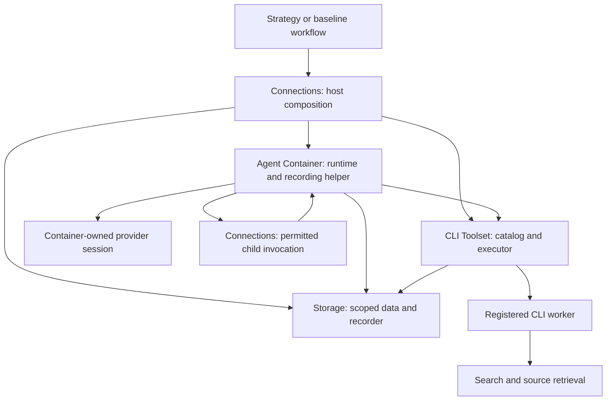

# Shared platform contract v1

Status: consolidated design for review, 2026-09-30. PM resolved the interface
differences below from all four leaders' narrow reconciliation replies.
This is documentation, not runtime code or authorization to implement.
It supersedes conflicting interface proposals in the team drafts. Required
runtime and live-service checks remain unperformed.

## Dependency direction and ownership



The invocation arrows represent bound interfaces, not a second runtime.
Shared serializable types and protocols have no implementation imports.
Connections is the composition root. Each module receives its dependencies
through protocols; module-owned factories create and close their resources.
The CLI worker has no database/root access. The executor mediates scoped
Storage operations. Providers return requested tool calls and never execute
tools themselves. Core modules contain no EBD strategy or task scheduler.

Proposed package ownership after implementation authorization:

| Owner | Exclusive paths |
| --- | --- |
| Agent Container | `src/ebd/agent/`, `src/ebd/providers/`, `tests/agent/`, `tests/providers/` |
| CLI Toolset | `src/ebd/toolset/`, `tests/toolset/` |
| Storage | `src/ebd/storage/`, `tests/storage/` |
| Connections | `src/ebd/connections/`, `tests/connections/` |
| PM | Shared contracts, package/CLI composition, baseline example, `tests/integration/`, manifests/lockfile and Git |

These are future assignments. Current editable paths remain those in
`CONTRIBUTING.md`. PM alone changes shared types/dependencies and performs
Git writes. Interface-change requests include affected consumers; teams do
not repair another module by editing its files.

## Compatibility, identity and authority

Use integer `schema_version: 1` as the sole wire/event compatibility major.
Definition revisions/digests, tool revisions, extraction format versions and
provider continuation codec versions are separate fields. Breaking changes
increment the major. Unknown execution/security settings fail validation.
Use strict finite JSON with unique keys, bounded depth and byte lengths.

| Identity | Allocator and meaning |
| --- | --- |
| `run_id`, `root_run_id`, `correlation_id` | Connections' trusted identity service; one execution and its lineage |
| `action_id` | Action owner; one agent run root, logical model generation, tool call or invocation |
| `attempt_id` | Action owner before every dispatch reservation, including the first; new on an explicitly permitted execution retry |
| `event_id` | Event producer before append; immutable record identity reused for delivery retries |
| `operation_id` | Trusted caller before a Storage mutation; reused for the identical write/status reconciliation |
| Native provider call/request ID | Provider; independent of engine IDs, preserved for conversation pairing |

A changed request or new model turn is a new action. An actual retry retains
the action but changes the attempt and consumes limits. Retrying delivery
of the same event/write retains all IDs and frozen content. No default
external retries; uncertainty never grants permission to replay execution.
Storage publication records reuse causal action/attempt IDs and carry their
own operation IDs. Connections does not invent a competing commit action.

Each agent run has a distinct root action for `agent.started/finished`, with
no dispatch attempt on those bookkeeping events. Model/tool/invocation
dispatches have separate actions and mandatory attempts. A child root points
to its parent's invocation action AND attempt. The standalone run root is
its actual tool action, so its tool intent/outcome carries the tool attempt.

A tool attempt is one admitted CLI worker dispatch. Explicitly permitted
named search fallback and fetch redirects occur within that worker and are
bounded observations (`backend_attempt_index`, backend/outcome), not extra
tool attempts. The immutable pre-dispatch search plan names all allowed
fallbacks. Relaunching a worker is a new execution attempt requiring another
durable intent. DDGS's internal HTTP request count remains unknown unless
instrumented; fallback permission is not permission for implicit worker replay.

`ExecutionContext` persisted metadata contains context kind
(`agent` or `standalone_tool`), run/root/correlation IDs, nullable agent and
definition reference, action/attempt IDs, parent run/action/attempt IDs,
UTC deadline, depth/ancestry, binding/policy references and bounded metadata.
Dispatch intents/outcomes require an attempt ID; nondispatch preflight may
omit one. A standalone tool has no invented agent or provider call ID.

Live context contains cancellation, a reconstructed monotonic deadline,
effective grants/revocation handle, shared lineage budget ledger and leases.
Live authority is issued by the trusted binder and never reconstructed from
JSON, an object reference or a saved descriptor. Child deadlines/grants only
narrow. All ancestors share one ledger; retries/children cannot reset quotas.
Scope creation and exporting a child result require explicit rights.

## Common results and recording

Infrastructure operations (Storage, binding, admission and provider opening)
use `Result[T] = Ok(value) | Err(error)`. Execution entry points instead return
domain outcomes (`AgentResult`, `ToolResult`, `ToolExecutionResult`,
`InvocationOutcome`, `ModelResponse`) containing anticipated execution
failure/refusal/incompletion. Do not wrap these in a second competing error
envelope. Unexpected defects retain exception semantics after bounded cleanup.
Python task cancellation
is cleaned up and re-raised; explicit engine cancellation returns a result.
Execution terminals are `succeeded`, `failed`, `validation_failed`,
`limit_exhausted`, `timed_out`, `cancelled`. An error code identifies the
specific failure. Recording is separately `complete`, `incomplete` or
`unavailable`; commitment and observed external effects are also separate.
Do not turn a known successful external effect into a claim of rollback.

Error envelopes include `code`, sanitized `message`, safe details and
observed effect state. Storage/delivery errors additionally include
`commit_state: not_committed|committed|unknown|not_applicable` and
`retryable_delivery`. These fields do not authorize external dispatch.

Canonical lifecycle producers:

| Producer | Events |
| --- | --- |
| Container runtime | `agent.started`, `agent.finished`, `model.intent`, `model.outcome`, `tool.intent`, `tool.outcome`, `tool.rejected`, validation/limit/cancel observations |
| Connections | `binding.resolved`, `binding.failed`, `invocation.intent`, `invocation.outcome`, nondispatch invocation rejection |
| Storage | State/artifact/snapshot/checkpoint publication events within its commits |

Do not also emit `run.accepted` for the same agent start. A rejected tool
has no execution attempt or process. Event markers such as `intent`,
`rejected` and `observed` are not extra agent terminal states.

`ExecutionEvent` carries version, event ID, kind, producer, causal context,
producer timestamp, bounded safe payload/references and relevant status,
duration/usage/error. Owner permissions restrict permitted event kinds.

`EventReceipt` contains `schema_version`, `store_id`, `event_id`,
`recorded_seq`, `recorded_at`, `duplicate`. Successful return means the
event committed under the verified Storage durability profile; no competing
`RecordAck` or caller-controlled durability flag. Sequence orders records.
An event cannot contain its own eventual append receipt.

Before model/tool/invocation dispatch, freeze and append the intent, obtain
its committed receipt, then recheck deadline/cancellation/grants. Without
a committed receipt, dispatch nothing. Known nondispatch after intent gets
a recorded outcome with `dispatched=false`. After dispatch, record the
observed outcome and cleanup before exposing success. Outcome recording
failure stops further dispatch and returns incomplete recording with the
known observation. Terminal-event failure preserves known execution facts.

`record_cleanup` is a separately bounded trusted context for owner-event
append, status reconciliation and lease cleanup after cancellation/deadline.
It authorizes no new model/tool calls or business writes. Storage stays alive
until admitted operations and terminal recording settle.

## Agent and model interfaces

`AgentDefinition` contains identity/revision/digest, instructions, input and
output schemas, named model/profile settings, required capabilities,
versioned allowed tools, Storage/delegation requests, context sources/policy,
limits and explicit error policy. No credentials or live handles.

Documentation signatures:

```text
async Runtime.admit(definition, task_input, binding, context)
    -> Result[AdmissionLease]
async Runtime.execute(admission_lease) -> AgentResult
async Runtime.admission_status(context, admission_id) -> Result[AdmissionStatus]
async AdmissionLease.release() -> Result[ReleaseReceipt]
async RecordedToolAction.run(tool_request, binding, context) -> ToolResult
ProviderFactory.capabilities(profile) -> ProviderCapabilities
async ProviderFactory.open(resolved_config, context) -> Result[ProviderSession]
async ProviderSession.generate(model_request, context) -> ModelResponse
async ProviderSession.aclose() -> CleanupReport
```

Admission reserves limits and returns a single-use, expiring lease, bound to
admission/run/root-action/definition/binding/ledger IDs and expiry. Its live
handle owns the reservation; its saved descriptor is not authority. Release
is idempotent and releases only known unconsumed reservations. Execute
atomically rechecks/consumes it and records agent start before external work.
Unknown consumption preserves identity/reservation for reconciliation, never
starts a second child. Authorized admission-status lookup returns reserved,
consumed/accepted, terminal, released, expired or unknown plus known receipts.
It is observational, never a resume/retry operation. The live owner is
authoritative; after process loss, saved history can establish known facts
but unresolved dispatch remains unknown. No cross-process automatic replay
or reconstituted admission is promised. Limits and cleanup have finite bounds.

`ModelRequest` contains ordered input items, allowed tool schemas with an
immutable provider-name map, output contract, validated settings, effective
limits, action identity and optional continuation. `ModelResponse` contains
public candidate content, ordered correlated tool calls, completion
(`final|tool_calls|incomplete|refused|failed`), native finish reason, nullable
usage, safe request/response IDs and opaque provider continuation. Candidate
text accompanying tool calls is intermediate. Native reasoning is not public
report text. Preserve provider-native continuation needed for subsequent
tool turns and version/bind its checkpoint codec to the selected provider.

Provider profiles cover real DeepSeek, OpenAI GPT-6-Luna Responses and an
explicit local vLLM Qwen deployment manifest. Missing local deployment does
not prevent API agents; local live verification remains pending. Binding and
capability validation do not incidentally call the network or change models.

The requested DeepSeek V4.1 Flash profile uses API model ID `deepseek-flash`,
as identified by [DeepSeek's current model documentation](https://api-docs.deepseek.com/quick_start/pricing/).
Reverify the selected account's actual model availability in the authorized
live acceptance; never silently substitute a legacy or different model.

Research uses only registered platform tools: system instructions prohibit
provider/internal search, and provider payloads expose only the registered
function tools. Record a sanitized rendered-request audit proving the actual
model/profile, instruction and tool names. Do not invent undocumented search
flags or confuse disabling thinking with disabling search.

## Tool interface and standalone path

`ToolDefinition` contains name/revision/description, closed input/output
schemas, capabilities, limits and trusted fixed argv/config/Storage needs.
The model sees schemas and descriptions, never argv, roots or authority.

```text
ToolCatalog.resolve(name, revision) -> Result[ToolDefinition]
async ToolExecutor.execute(definition, arguments, context, storage_plan)
    -> ToolExecutionResult
async ToolExecutor.close(deadline) -> CleanupReport
```

`ToolExecutionResult` is an internal execution/commit observation.
`RecordedToolAction` adds the durable terminal record to produce public
`ToolResult`: version, tool/invocation identity, execution status, result or
error, safe observations/process/usage, persistence receipt/state,
recording status and event IDs. Success requires successful execution,
required committed snapshot and complete lifecycle recording.

The one-shot worker exchanges exactly one UTF-8 JSON request/response;
diagnostics use bounded stderr. No shell, arbitrary executable or public
reserved control fields. The executor validates input, output, identity,
exit/phase consistency, deadline, process-tree termination and pipe cleanup.

Private `WorkerRequest` contains tool identity, invocation, public arguments
and trusted injected execution limits/deadline/search or Storage plan.
Private `WorkerResponse` has `phase: prepared|failed`, exactly one prepared
payload/error and bounded observations. Exit zero means prepared, not public
success. Search prepares ranked discoveries; read returns the exact injected
authoritative slice; fetch prepares retained original bytes, derived text,
page/line index, provenance and assigned operation ID. Workers cannot supply
grants, finalized snapshot references or publication receipts.

For fetch, the executor validates the prepared bundle and calls scoped
`SnapshotStore.commit`; only Storage's complete READY receipt can become
a public snapshot result. For read, it obtains an authorized immutable
`DocumentSlice` from Storage and injects it before worker dispatch. The
durable tool intent precedes worker/network/read activity. No private broker
or additional IPC service is required for this initial bounded profile.

The host CLI composition performs Connections bootstrap/binding, then calls
the same Container-owned `RecordedToolAction` as agent tools. Canonical
producer is `runtime`, distinguished by `context_kind=standalone_tool`.
Toolset owns CLI parsing and workers; neither runner nor executor adds a
duplicate lifecycle logger. No model is opened. Internal workers are
unsupported direct entry points and reject missing/malformed envelopes.
Parent-held bindings enforce authority; a valid-looking worker envelope
does not authenticate its launcher. This interface does not isolate trusted
same-user commands at the OS level or promise to prevent forged direct use.
Standalone uses a fresh scope; reading an old snapshot needs an explicit
grant. An already-owned store root returns `STORAGE_BUSY`; attachment to an
active engine is outside this initial interface.

## Storage interface and failure semantics

All operations are async, context-first and scoped. SQLite work runs on its
owned serialized worker. Expected failures use the common result envelope.
The authoritative Storage draft supplies full schema details where compatible
with this reconciliation.

```text
StateStore.get(context, scope, key) -> Result[StateLookup]
StateStore.get_version(context, scope, key, version) -> Result[StateLookup]
StateStore.commit(context, operation_id, mutations, activity) -> Result[StateCommitReceipt]
ArtifactStore.put(context, operation_id, scope, content, metadata) -> Result[ArtifactReceipt]
ArtifactStore.open(context, artifact_ref, byte_range, max_bytes) -> Result[ArtifactRead]
SnapshotStore.commit(context, operation_id, scope, proposal) -> Result[SnapshotReceipt]
SnapshotStore.read(context, snapshot_ref, range, max_text_bytes, continuation) -> Result[DocumentSlice]
CheckpointStore.save(context, operation_id, scope, checkpoint) -> Result[CheckpointReceipt]
CheckpointStore.load(context, checkpoint_ref, accepted_formats) -> Result[CheckpointEnvelope]
ActivityRecorder.append(context, event) -> Result[EventReceipt]
ActivityRecorder.status(context, event_id, expected_event_digest) -> Result[EventStatus]
ActivityReader.query(context, filters, cursor, limit) -> Result[ActivityPage]
OperationStore.status(context, operation_id) -> Result[OperationStatus]
StorageSession.close(deadline) -> Result[CloseReceipt]
```

State mutations require an expected version; zero creates a never-seen key.
Deletes retain versioned tombstones. Batch updates and their publication event
commit in one SQLite transaction. Artifact/snapshot/checkpoint acknowledgment
requires sealed verified bytes and READY metadata/event. Files and SQLite
have separate recovery boundaries, not a joint atomic transaction. References
are store-qualified opaque identifiers, never file paths or authority.

Same ID plus identical canonical request/origin returns the original receipt;
different content/origin is an idempotency conflict. Reauthorize before lookup.
After an uncertain acknowledgment, query/retry only the same append/write.
Absence at one observation does not prove no queued write exists. Known
not-committed requires confirmed nonadmission/rollback or durable abort;
an admitted/sealed write remains pending/unknown until its owner settles.
Cancellation cannot undo a committed mutation or trigger external replay.

Baseline settings: single store-root owner, SQLite DELETE journal,
synchronous EXTRA, foreign keys enabled, short bounded transactions and
verified startup settings. Explicit WAL requires the patched-runtime gate
in the Storage design; never silently switch journal modes. This is not a
hardware power-loss guarantee. Closing a borrowed lease does not close the
shared store; unresolved admitted writes retain their owner/resources.

Document ranges are tagged lines/pages, one-based, end-exclusive. Physical
PDF pages include empty pages. Empty text has zero lines; a trailing LF adds
no phantom line. Valid boundaries are `1 <= start <= end_exclusive <= N+1`;
zero units permit only `[1,1)`. Never clamp. Preserve empty page spans.
UTF-8 byte offsets are zero-based. Continuation binds the immutable snapshot,
extraction and original requested range; grants are checked again. Return
requested/actual spans, truncation, remaining-within-range/document and an
advancing cursor. If the next code point cannot fit, report its required
bytes rather than returning a zero-progress continuation.

## Connections and invocation

Central configuration loads `local/.env` with explicit process-environment
precedence, validates named profiles lazily and gives secrets only to their
module owner. Non-secret descriptors are immutable and pinned to registry,
definition/config revisions. Live handles and secrets are never serialized.

```text
async Engine.open(settings) -> Result[Engine]
Engine.register_agent(definition, invocation_rules) -> Result[RegisteredAgent]
async Engine.bind(agent_ref, context) -> Result[BoundSession]
async Engine.run_agent(agent_ref, task_input, options) -> AgentResult
async Engine.run_tool(tool_ref, arguments, options) -> ToolResult
async AgentInvoker.invoke(caller_context, destination, input, options) -> InvocationOutcome
async Engine.close(deadline) -> CleanupReport
```

The host opens Storage/control recorder before binding. Bootstrap failure
dispatches nothing. BoundSession contains BindingSet and a resource lease;
the binding supplies restricted provider factory/profile, catalog/executor,
scoped Storage, owner-restricted recorder, invoker and identity service.
Binding performs local validation and durable binding recording, not execution.

Child invocation validates destination/input/grants, allocates/binds a child,
obtains Runtime admission, durably records parent invocation intent, then
consumes that admission. Runtime owns the child loop/start/terminal; Connections
owns parent intent/outcome and authorized result export. Preserve child terminal
facts even if export or parent recording fails. Release an unconsumed lease
on known nondispatch; retain uncertain accounting for lookup. Cancellation
propagates downward. Stop admission, drain execution/recording, release module
leases, then close Storage. This adds no hidden scheduler or implicit retry.

## Resource profile and acceptance gates

Initial bounded mediation targets the smaller proposed limits: decoded original
8 MiB, text 4 MiB, index 1 MiB, provenance 64 KiB, stdin 1 MiB, fetch stdout
20 MiB, public JSON 512 KiB, stderr 64 KiB, JSON depth 32, reads 64 KiB and
at most 200 lines/10 physical pages. Limits may narrow through bindings.
Measure one fetch first, then at most two concurrent fetches. These are
enforcement targets, not measured RAM or latency guarantees. Check actual
encoded JSON/base64/escaping; reject a bundle that exceeds the total envelope.

Before runnable teammate handoff, verify:

1. One uv/Python 3.11+ environment and committed lockfile; no global dependencies.
2. Real DeepSeek and GPT-6-Luna tool conversations and preserved continuation;
   Qwen implementation/configuration checks with live deployment explicitly pending.
3. DDGS named-backend outcomes, representative research queries and URL fidelity;
   static HTML/plain-text/text-PDF fetch, retained-body hashes and stable reads.
4. Intent-before-dispatch, denied/no-recording nondispatch, exact-ID deduplication,
   ambiguous append/commit recovery and no external replay; CAS/scope isolation.
5. Max-fit/escaped bundles, PDF parser expansion, peak parent/worker memory,
   Windows descendant cleanup/reaping, byte-drain caps and cancellation around commit.
   If required documents do not fit, return to the user with measured streaming scope.
6. Root/child/standalone limits, attenuation, result export, revocation and lease shutdown.
7. A simple baseline consumes only these module APIs to answer
   "What is EBD (Environment Based Design)" using DeepSeek V4.1 Flash;
   it saves a complete sourced report and auditable model/tool/storage trace.
   Provider/internal search remains disabled. No manually supplied mock report.

Runtime implementation and live API acceptance require the design-phase
transition to be authorized. Automatic approval review has blocked that
transition based on the earlier design-first instruction; this document makes
the proposed work concrete for that review without starting it.
