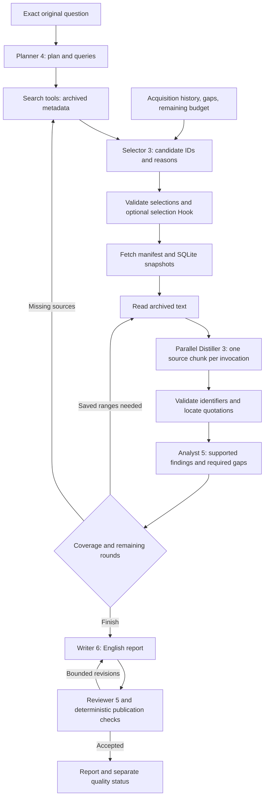

# Baseline revision 9: explicit Agent instructions and output instances

Request `method_id: "baseline", method_revision: 9`. This revision keeps revision
7's executable input/output schemas, tools, selection algorithm, research rounds,
repair policy, source delivery and limits. Revision 8 first replaced all six
instruction/task bundles; revision 9 refines Selector, Distiller and Analyst after
retained live failures. Old role resources and saved runs remain unchanged. Wire
schema and HTTP API versions stay at 1; the request's compatibility default remains
method 1.

## Roles and contracts

| Role pin | Receives | Returns | Critical binding |
| --- | --- | --- | --- |
| `baseline.planner@4` | Original question, supplied queries, query limit | JSON: `schema_version`, `objective`, `questions`, `queries`, `outline` | Questions become exact downstream keys; generated queries do not replace the original question |
| `baseline.selector@3` | Plan, candidate metadata, acquisition history, gaps, budget, inventory coverage | JSON: `schema_version`, `selections`, `deferred`, `rejected` | Every delivered candidate ID appears exactly once with a reason; immediate selections respect both fetch limits |
| `baseline.distiller@3` | One source/chunk, actual archived text segments, plan, repair feedback | JSON: `schema_version`, `source_id`, `chunk_id`, `content_kind`, `summary`, `findings`, `limitations`, `reference_queries` | Copy source/chunk/segment IDs and entire planned-question strings; quotations must occur in the supplied segment |
| `baseline.analyst@5` | Plan, validated digests and delivered text, available source IDs, round | JSON: `schema_version`, `findings`, `gaps`, `follow_up_queries`, `sufficient`, `follow_up_reads` | Exact planned questions and available source IDs; distinguish required gaps from optional expansion |
| `baseline.writer@6` | Plan, analysis, evidence, quality, review feedback | Raw English Markdown | Exact available `[source-id]` citations and `Research coverage: STATUS`; qualify claims to what the cited evidence supports |
| `baseline.reviewer@5` | Same evidence/analysis, report, quality | JSON: `schema_version`, `verdict`, `issues` | `accept` has no issues; `revise` has 1–8 concrete, actionable issues |

Each resource directory contains the standard five files: `definition.json`,
`instructions.md`, `task.md`, `input.schema.json`, `output.schema.json`. The JSON
schemas remain the executable contract. Instructions describe that contract and
show valid output **instances** instead of embedding a large schema that can be
mistaken for the answer. Examples are synthetic; their facts and IDs are never
evidence for a live task. Task templates label supplied data and repeat the most
important completion checks next to the actual input.

All six roles use the common Runtime with no tools. JSON roles emit one object
without a Markdown fence or explanatory wrapper. Writer emits Markdown directly,
not a JSON string or object. Role instructions cover required fields, types,
counts/lengths, provenance, insufficient evidence and feedback handling. The
Runtime's existing output validation remains strict; no permissive parser or
silent fallback was added.

Revision 9 makes classification an explicit mutually exclusive partition, tells
Distiller repair to drop a rejected quotation instead of reconstructing it, and
requires Analyst to separate gaps preventing the requested answer from optional
research expansion. A definition can synthesize several passages; it need not
appear as one canonical sentence. These remain model instructions, not new host
validation or a guarantee of compliance. See the comparison for actual outcomes.

## Flow, limits and failure behavior



The read-request branch uses already archived text; it does not grant another
fetch. See [source access and budgets](baseline-parallel.md) and
[candidate decisions and Hooks](baseline-selection.md) for the shared mechanisms.
At most 20 unique URL attempts are allowed globally, including failures, with
at most two research rounds. Early stopping remains possible. Every Agent has
a 262,144-token context limit and an 8,192-token response limit. Selected evidence
defaults to 131,072 estimated tokens and 524,288 bytes, distinct from Agent context.

The configured maxima remain six Selector calls, 20 Distiller calls including
repairs, four concurrent Distillers and four Writer/Reviewer pairs. There is no
new retry path: Runtime JSON/schema failures terminate the run, while the existing
Distiller semantic/quotation validation can request one bounded repair. Instruction
changes may reduce errors but cannot guarantee model compliance.

## Run and inspect

The [standard request](../../examples/baseline-request.json) selects revision 9.
Use a fresh `client_request_id` and store for each new experiment:

```shell
uv run --locked python examples/live_research_check.py --request examples/baseline-request.json --store local/instruction-baseline --output local/instruction-baseline-evidence
```

All EBD experiments preserve exactly `What is EBD (Environment Based Design)?`,
without supplied seed URLs unless separately declared. Generated queries are
recorded separately, and reports are English. The method manifest pins every
role's five resource hashes. Existing node events and artifact APIs expose the
exact role inputs, outputs, decisions, failed validation diagnostics, usage and
saved source text; no new frontend route is required.

See [the instruction comparison](../instruction-comparison.md) for retained
failures, paired frozen-input checks and full-run comparisons with revisions 5
and 7. Live search and model variability prevent treating a single report or
lower token count as proof of better research.
