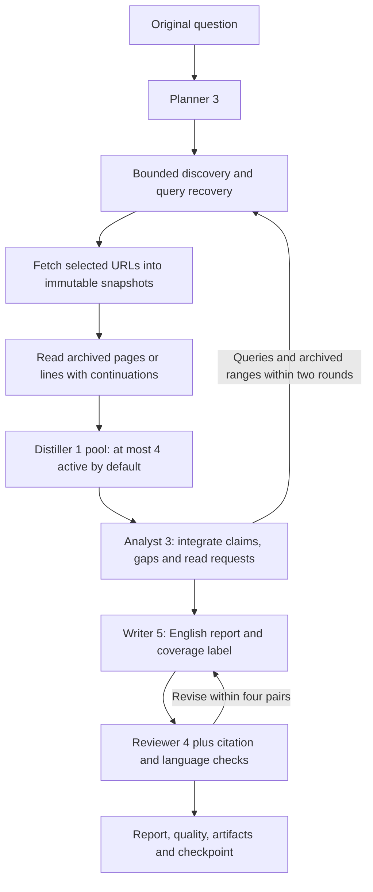

# Baseline revisions 5–6: parallel source distillation

Select `method_id: "baseline", method_revision: 6`. Revision 6 upgrades only the
search tool bindings to web revision 3 and scholarly revision 2, preserving
provider bibliography and explicit first-page coverage. Its research policy,
Agent roles and limits are the same as revision 5. Older revisions keep their
role bundles and remain executable. The standard request is
[examples/baseline-request.json](../../examples/baseline-request.json).
All EBD experiments preserve exactly `What is EBD (Environment Based Design)?`;
generated and prepared search queries are separately recorded data. The method
also accepts arbitrary research questions. Final reports use English.

## Execution and ownership



The root has no model or provider. All five roles run in the same common Agent
Runtime. A source Distiller receives only its host-identified document/chunk,
the original question and plan, and recorded source segments. It never fetches
inside its own conversation. Up to four Distillers execute concurrently through
the scoped invoker, with distinct children and exports. A narrower host limit
queues work. Cancellation or failure cancels and drains sibling tasks before
the method can finish. Node and usage projections are serialized.

Sources are read in bounded 10-page/200-line requests with all advancing
continuations. PDF batch separators are preserved and overlapping bytes are
verified/deduplicated. A source access manifest records its snapshot, total and
read byte counts, completeness, segment ranges, byte offsets/hashes and read
action IDs. Each chunk fits a finite Agent input; large documents can create
multiple chunks. A read or distillation allowance can leave explicit partial
coverage. A large context allowance does not imply a document was fully read.

Distillers classify substantive text, abstracts, bibliographies and irrelevant
content. Their claims include short quotations and exact segment IDs; the host
validates quotations against recorded bytes before using a digest. Comparison
permits whitespace and ASCII word hyphens at PDF line breaks, then retains the
actual original substring. It never repairs OCR, punctuation, formulas or words.
If a quote exists uniquely in another segment already supplied to that worker,
the host corrects that known segment pointer and saves `validation_changes`;
unknown IDs and quotations absent from the supplied chunk remain errors.
Specific failed-quote feedback allows one repair under the same call allowance.
Source-worker
summaries remain derived analysis, not independent publications. The Analyst,
Writer and Reviewer receive the digests plus verified original text/excerpts.
When the complete saved text fits, it is delivered, including tail pages.
Otherwise verified quotes and specifically requested ranges take precedence.
The ContextPlan records the exact delivered bytes. Original snapshots remain
available for bounded source reads through the existing service/API.

Planner 3 keeps a definition question focused on its definition, origin/core
method and useful applications. Retrieval simplifies long derivative queries
and tries a finite number of distinct simpler/cited-title variants. It retains
raw backend outcomes and every preparation/screening decision. Related cited
foundations may match by title/author cues without containing all topic words.
DOI/OA/PDF/landing alternatives come from actual discovery payloads or archived
access links; no publisher URL template is fabricated. An accessible substantive
copy confirmed by a Distiller suppresses equivalent work alternatives. DOI/work
identities and byte-identical text deduplicate the substantive-source count.
Failed/abstract/bibliography
retrieval can trigger alternate acquisition inside the existing round budget.
Optional unavailable scholarly admission is recorded; it never enables paid access.
A known terminal `SEARCH_UNAVAILABLE` with acknowledged recording, completed
worker cleanup and no persistence operation allows fallback/recovery while
retaining earlier candidates. Unknown commitments and unsettled workers still stop.

Analyst 3 can request known saved source page/line ranges and short searches for
missing documents. The next round honors those ranges, promoting cached text
or issuing fresh recorded reads. Unchanged digests are reused. Two rounds remain
the maximum; optional comparisons/global adoption history do not become required
gaps merely because the input is a simple definition question.

## Module interfaces

| Module | Input / output | Responsibility |
| --- | --- | --- |
| `workflows/components/retrieval.py` | `retrieve_candidates(...) -> (FetchItems, discovery entries)` | Query recovery, real work/location identities, ranked alternatives |
| `workflows/components/acquisition.py` | `FetchManifest -> SourceManifest` | Recorded URL fetch and immutable snapshots |
| `workflows/components/source_access.py` | `read_retained_source(...) -> segments + access_ref` | Complete or explicitly partial archived reads with provenance |
| `workflows/components/parallel.py` | `bounded_map(items, worker, concurrency)` | Finite admission, ordered outputs, sibling cancellation/drain |
| `workflows/components/quotations.py` | `locate_quote(quote, text) -> original substring or None` | Deterministic saved-text location, including PDF soft word wraps |
| `methods/baseline/stages/distillation.py` | Sources/read segments -> validated digests | Method-specific source role, quote checks and reuse |
| `methods/baseline/stages/evidence_delivery.py` | Reads/digests -> evidence + ContextPlan | Verified evidence delivery and requested-range promotion |
| `methods/baseline/parallel_workflow.py` | Question/parameters -> report/result/quality | Round, fetch, call and quality policies |
| `agent_catalog/resources/<role>/<revision>/` | Five standard role resources | Versioned instructions, task templates, schemas and limits |

All components use WorkflowContext/PlatformPort. Concrete methods do not open
SQLite, providers or HTTP clients. Bootstrap pins Planner 3, Distiller 1,
Analyst 3, Writer 5 and Reviewer 4. Baseline 5 pins `web.search@2`; Baseline 6
pins `web.search@3` and both scholarly tools at revision 2. See the
[search result contract](tools.md#complete-discovery-information). Hooks observe each source-read,
distillation and validation node; selection controls remain `discovery.select`
and `context.select`. The method runs with no extensions installed.

## Budgets

| Allowance | Default / scope |
| --- | --- |
| Research rounds | 2 total |
| Attempted source URLs | 20 total, including failures; by default reserve 10 for each round |
| Primary queries | 2 per round, configurable 1–4 |
| Recovery queries | 4 additional distinct queries per round, configurable 0–4 |
| Discovery results | 5 per tool call, configurable 1–10 |
| Source read bytes | 1 MiB per source; configurable 1 KiB–4 MiB, partial when capped |
| Distillation model calls | 20 total including quote-validation retries; configurable 1–20 |
| Distiller concurrency | 4, configurable 1–8; host default admits 4 active descendants |
| Distinct substantive sources | At least 2 for sufficient coverage by default; configurable 1–5 |
| Synthesis evidence | 131,072 estimated tokens / 524,288 UTF-8 bytes |
| Every Agent context | 262,144 tokens; provider/host may narrow it |
| Draft/review pairs | At most 4, separate from research rounds |

The default host grants 32 total model calls and 32 cumulative descendants;
the worst configured role count is 1 Planner + 20 Distiller calls + 2 Analyst
calls + 8 Writer/Reviewer calls = 31. Calls share the original ledger/deadline,
including failed attempts. Tool calls, Storage reads/writes/bytes and output
bounds remain independent. Simultaneously exhausting every parameter maximum
is not guaranteed to fit a narrower host. Token estimates remain explicitly
`utf8-byte-size/4`; exact provider usage is recorded per attempt and aggregated.

## Frontend and saved access

`ResearchRunView.quality` is optional for compatibility with older methods and
available for baselines 5–6. The wire major stays 1. Interpret it separately from
`status`, `recording_status` and `active`:

```json
{
  "schema_version": 1,
  "status": "partial",
  "report_accepted": true,
  "evidence_sufficient": false,
  "attempted_sources": 7,
  "substantive_sources": 1,
  "fully_read_sources": 3,
  "distilled_sources": 3,
  "gaps": ["A required primary-source definition is still unavailable."],
  "reasons": ["Too few distinct substantive source documents for the selected coverage policy."]
}
```

This is a contract example, not an observed acceptance result. `sufficient`
requires the Analyst's sufficiency judgment, all essential planned questions,
no unresolved required gaps/reads/delivery limits, and the selected substantive
source count. `partial` has substantive evidence but unresolved coverage;
`insufficient` has no substantive source support. Report acceptance can be true
in any of these states when the limited answer is properly qualified. The report
includes `Research coverage: <status>`; structural checks prevent silently
presenting partial research as complete.

If the Analyst reports `sufficient=true` while also reporting gaps or read
requests, the host conservatively records `sufficient=false`. It retains the raw
`analyst_output_ref`, publishes a separate validated `analysis_ref`, and saves
`analysis_adjustments`. This contradiction continues bounded research rather
than discarding already validated evidence or upgrading coverage.

Read `GET /api/v1/research-runs/{run_id}` for quality and lifecycle. The result
artifact contains `source_access_ref` and `distillations_ref`, with per-round
references and provenance. Open each via the existing bounded
`GET /api/v1/research-runs/{run_id}/artifacts/{artifact_id}` route. Distillation
records link the saved Agent task input (`input_ref`), raw exported role output
and validated evidence; access
manifests link the immutable snapshot and recorded read actions. Agent node
details and `workflow.evidence.distilled` events also expose `input_ref` so hooks
and frontends can inspect the exact source chunk while it runs. Use
`POST /api/v1/research-runs/{run_id}/sources/{item_id}/read` for original text,
preserving range/continuation semantics. Reopen reads these saved facts and does
not rerun models, discovery or fetch. See [ResearchRun API](research-service.md).

```shell
uv run --locked python examples/live_research_check.py --request examples/baseline-request.json --store local/parallel-baseline --output local/parallel-baseline-evidence
```

Use a fresh client request identity for every new experiment. Actual validation
and live observations are recorded in [research acceptance](../research-acceptance.md).
