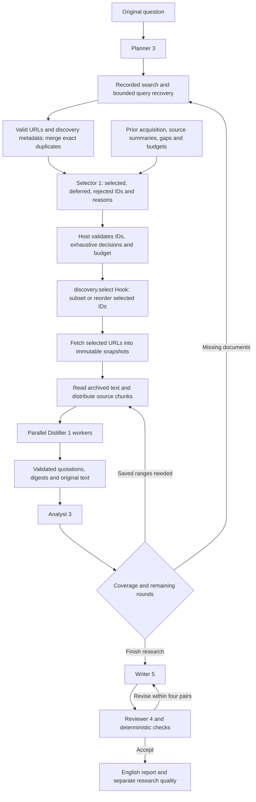

# Baseline revision 7: Agent candidate selection

Revisions 8 and 9 pin revised instructions for all six roles while retaining this
selection implementation; see [instruction usage](baseline-instructions.md). The
standard example requests 9; explicitly request 7 to reproduce this revision.

Request `method_id: "baseline", method_revision: 7`. Revision 7 replaces
revision 6's lexical candidate screening and fixed location ranking with
`baseline.selector@1`. Search tools, other role revisions, research-round
policy, source reading, distillation, synthesis and review are retained.
Revision 6 remains an explicit rule-selection control. Method version and
HTTP/wire schema versions remain separate; the request default is still 1.

All six roles are tool-free and use the same Runtime. The Selector does not
fetch, browse or write Storage directly. It receives discovery metadata, not
the candidate document body, and must not treat that metadata as citation
evidence. A valid URL reaches the Selector even when its title/snippet lacks
the exact topic phrase. `search_topic` remains a query-preparation hint.

## Selector contract and policy

| Input | Meaning |
| --- | --- |
| `question`, `plan` | Exact user question and Planner output |
| `candidates` | Host IDs, actual URLs/work identities, titles, snippets, bibliography, discovery provenance and truncation notes |
| `history` | Attempted URLs/statuses, complete-read flags, content classifications, source summaries and error codes |
| `gaps` | Analyst gaps and host coverage reasons from the preceding round |
| `budget` | Remaining total URL attempts, this batch's allowance, current round and maximum rounds |
| `coverage` | Total/delivered/omitted candidates and candidate metadata truncation counts |

The JSON output has `schema_version: 1` and three ordered lists: `selections`,
`deferred` and `rejected`. Every entry contains only `candidate_id` and a brief
English `reason`. Every delivered ID must occur exactly once. The host rejects
invented/duplicate/missing IDs and selections over the batch or total allowance.
Only immediate selections can be fetched. Deferred candidates return to a later
selection decision with updated history; they do not grant automatic fetching.
Archived access links also go through selection before acquisition. The existing
`discovery.select` Hook may narrow/reorder the Agent's selections, not add an
unselected URL. Invalid Agent output fails visibly; there is no silent rule fallback.

The Selector weighs question relevance, missing coverage, authority and likely
accessibility. It distinguishes ambiguous acronyms and can recognize foundations
without exact topic words. It prioritizes user-supplied URLs unless clearly
irrelevant, selects at most one location per work in its immediate plan, and
defers alternatives until a preferred location fails or supplies inadequate text.
The host retains same-work suppression and global attempted-URL deduplication.
These are selection judgments, not verified conclusions about unread documents.

## Bounds and saved decisions

At most 128 candidate cards and 262,144 serialized card bytes are delivered per
decision. Metadata previews preserve up to 2,048 UTF-8 bytes each of title/snippet,
4,096 abstract bytes, eight author names and three container titles. Every preview
truncation and omitted card is recorded. Omitted candidates remain pending for a
later decision; raw discovery artifacts preserve the original tool payloads.
This bounded inventory is not a claim of exhaustive search or consideration.

The method admits up to three selection calls per round (initial, all-failed
fallback, and recovery), hence six total. Selection uses the normal 262,144-token
Agent context and 8,192-token output limits. Existing limits remain 20 attempted
URLs including failures, two rounds, 20 Distiller calls including repairs, four
parallel Distillers and four draft/review pairs. There is no Selector retry loop.
The default host envelope is 40 model calls and 40 cumulative descendants, fitting
the configured maximum of 1 Planner + 6 Selectors + 20 Distillers + 2 Analysts +
8 Writer/Reviewer calls = 37. Host policies can narrow those allowances.

The result and each round contain `selections`. Each invoked selection links:

- `inventory_ref`: candidate inventory and explicit coverage bounds.
- `input_ref`: exact structured task sent to the Selector.
- `output_ref` and `validation_ref`: saved model decision and validated ID/URL bindings.
- `hook_selected_ids`: the selections admitted after optional Hooks.
- `fetch_manifest_ref`: the URLs actually attempted by that batch.

Nodes `*.select.sources` and `*.select.bindings` expose input/output references
through existing node events and Hooks. Fetch source IDs are assigned separately;
join the decision bindings to the batch manifest by the exact URL. Read artifacts
through `GET /api/v1/research-runs/{run_id}/artifacts/{artifact_id}`. No new HTTP
route or wire-schema change is needed. Input/output schemas and role instructions
are under `agent_catalog/resources/baseline.selector/1/`; decision validation and
metadata delivery are under `methods/baseline/stages/selection.py`.

Use [the standard request](../../examples/baseline-request.json) and the commands
in [parallel baseline usage](baseline-parallel.md). All EBD experiments preserve
exactly `What is EBD (Environment Based Design)?`; generated queries remain
separate data, and reports remain English. Compare v6 and v7 with identical
requests except fresh client identities and method revisions, identical model
profiles/admission, and fresh stores. Record failures as well as successful runs;
live search and model variability mean one pair is exploratory evidence.
